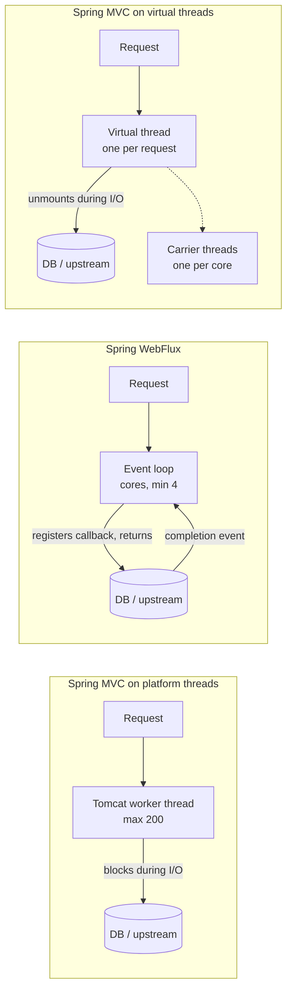
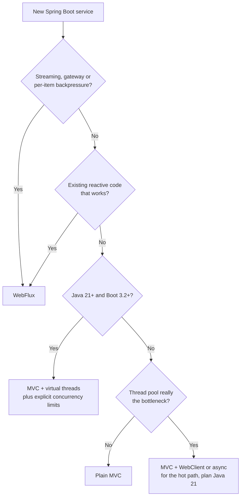
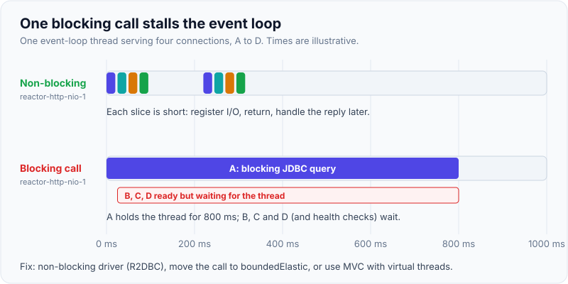

# WebFlux vs MVC vs virtual threads — when to choose

!!! abstract "Key takeaways"
    - All three answer one question: **what holds the request while it waits for I/O?** MVC: a pooled **platform thread** (Tomcat default max 200). WebFlux: **nothing**, a callback on a few **event-loop** threads (one per core, minimum 4). MVC + virtual threads: a **virtual thread** that unmounts from its carrier while it waits.
    - **Default for new request/response services on Java 21+ and Boot 3.2+: Spring MVC with `spring.threads.virtual.enabled=true`.** Plain code, JDBC/JPA, real stack traces, scale similar to reactive for I/O-bound work.
    - **Choose WebFlux** for streaming (SSE, WebSocket, large NDJSON), gateways and proxies, end-to-end non-blocking stacks (R2DBC, reactive drivers), or where you need operator-level **backpressure**. Keep existing, working reactive code.
    - **Neither model makes the database bigger.** With virtual threads or WebFlux the thread pool no longer limits concurrency, so the connection pool, a `Semaphore` or `flatMap` concurrency must.
    - The fatal mistake in WebFlux is **blocking on the event loop**: one blocked thread stalls every connection on that loop.

## Why it matters

"Should this service be reactive?" is one of the most common Spring architecture questions in Lead interviews, and the honest answer changed with Java 21. The interviewer wants to hear that you understand the **thread model** behind each option, can estimate whether threads are actually the bottleneck, and pick based on workload and team, not fashion. The Spring team's own guidance is blunt: if a Spring MVC application works fine, there is no need to change, and blocking dependencies such as JPA and JDBC point to MVC.

This page compares the three. The mechanics of virtual threads (mounting, pinning, why not to pool them) are on the [virtual threads page](../java-concurrency-jvm/07-virtual-threads-and-structured-concurrency.md), and how Boot wires them is in [Spring Boot 3.x](../spring-boot/10-spring-boot-3-x-jakarta-ee-graalvm-native-image-virtual-thre.md). Reactor itself is on [page 1](01-reactive-streams-and-project-reactor.md).

## Core concepts

### Do you even have a thread problem?

Little's law: **requests in flight = throughput × latency**. At 1,000 requests/s with 200 ms of mostly waiting per request, you need 200 requests in flight, which already fills Tomcat's default 200 threads. At 300 requests/s and 50 ms, you need 15. Most internal services are in the second group, and changing the concurrency model will not help them. Measure before migrating: if threads are busy but CPU is low and requests queue, the thread model is the bottleneck. If CPU or the database is saturated, no model fixes it.

### Three thread models


*Notice that only the first model keeps an OS thread busy during I/O. WebFlux and virtual threads both free the OS thread; they differ in whether your code is written as callbacks (operators) or as straight-line blocking code.*

{ loading=lazy }
*Same load, three models: only the platform-thread pool makes requests queue for a thread.*

### Side-by-side

| | MVC (platform threads) | WebFlux (event loop) | MVC + virtual threads |
|---|---|---|---|
| Since | Always | Spring 5 (2017) | Java 21 + Boot 3.2 (2023) |
| Server | Tomcat/Jetty/Undertow (Servlet) | Reactor Netty (default) or Servlet containers | Tomcat/Jetty |
| Threads | Pool, default max 200 | ≈ CPU cores, min 4 | One virtual thread per request, carriers ≈ cores |
| Code style | Imperative | `Mono`/`Flux` operators or coroutines | Imperative |
| Blocking libraries (JDBC, JPA) | Fine | Must wrap or replace (R2DBC) | Fine |
| Stack traces, debugger | Normal | Reactor frames, need checkpoints | Normal |
| `ThreadLocal`, MDC, `@Transactional` | Work | Need Reactor `Context` and reactive TX manager | Work (keep them small) |
| Backpressure and streaming operators | No | Yes | No (use semaphores, queues) |
| Typical limit at high load | Thread pool | CPU, downstream | Downstream (DB pool), pinning on Java 21–23 |
| Learning curve | Low | High | Low |

### Mixing is allowed

The choice is not all or nothing:

- **MVC + `WebClient`**: an MVC controller can call `WebClient` and return a `Mono` or `Flux`; Spring MVC handles reactive return types through async request processing. Useful for one streaming endpoint in an otherwise blocking service.
- **WebFlux + blocking executor**: since Spring Framework 6.1, WebFlux can run **blocking controller methods** (non-reactive return types) on an executor via `WebFluxConfigurer#configureBlockingExecution`. Spring Boot uses its `applicationTaskExecutor` for this, which is virtual-thread based when `spring.threads.virtual.enabled=true`.
- **Spring Cloud Gateway** now ships both a WebFlux server and a **Server MVC** variant (Spring Cloud Gateway 4.1+), which tells you the Spring team sees blocking-on-virtual-threads as a valid gateway model too.

### What virtual threads do not give you

Virtual threads give WebFlux-like **scalability** with MVC-like **code**. They do not give you a streaming operator library, demand-based backpressure, or composition such as `switchMap`, `zip` with timeouts per branch, or windowing. They also bring their own caveats: pinning inside `synchronized` until Java 24 (JEP 491), `ThreadLocal` caches multiplied by a million threads, and no pool to limit downstream concurrency. Netflix hit a deadlock in 2024 when all carrier threads were pinned waiting on a lock, which is the classic production story.


*Notice that WebFlux wins on capabilities (streaming, backpressure), not on raw throughput. The default for ordinary request/response work is now virtual threads.*

## In practice: code & configuration

=== "❌ Common mistake"
    ```java
    // WebFlux controller with a blocking repository: runs on reactor-http-nio-N.
    @GetMapping("/claims/{id}")
    public Mono<Claim> claim(@PathVariable Long id) {
        return Mono.just(jpaRepository.findById(id).orElseThrow()); // JDBC blocks the event loop.
        // With 8 event-loop threads, 8 slow queries freeze every connection on the server,
        // including health checks, so Kubernetes restarts the pod.
    }
    ```

=== "✅ Option A: MVC + virtual threads"
    ```yaml
    # application.yml (Boot 3.2+, Java 21+; prefer Java 24+ to avoid synchronized pinning)
    spring:
      threads:
        virtual:
          enabled: true          # Tomcat handles each request on a new virtual thread
      datasource:
        hikari:
          maximum-pool-size: 30  # now the real concurrency limit for DB work
          connection-timeout: 2s # fail fast instead of piling up waiting virtual threads
    ```
    ```java
    @GetMapping("/claims/{id}")
    public Claim claim(@PathVariable Long id) {
        return jpaRepository.findById(id).orElseThrow(); // plain blocking code, cheap to block
    }
    ```

=== "✅ Option B: stay reactive"
    ```java
    // End-to-end non-blocking with R2DBC; or, as a bridge, wrap the blocking call.
    @GetMapping("/claims/{id}")
    public Mono<Claim> claim(@PathVariable Long id) {
        return r2dbcRepository.findById(id)                        // ReactiveCrudRepository
            .switchIfEmpty(Mono.error(new ClaimNotFoundException(id)));
    }

    Mono<Claim> legacy(Long id) {
        return Mono.fromCallable(() -> jpaRepository.findById(id).orElseThrow())
            .subscribeOn(Schedulers.boundedElastic());             // bridge only; bounded at 10 x cores threads
    }
    ```

The first version is so damaging because an event-loop thread is shared by many connections, as the timeline shows.

{ loading=lazy }
*One slow blocking call delays every other connection on that loop, health checks included.*

Limiting a downstream once the thread pool no longer does it for you:

```java
@Service
class EligibilityClient {
    private final Semaphore permits = new Semaphore(20);   // upstream handles about 20 concurrent calls
    private final RestClient rest;

    EligibilityClient(RestClient.Builder builder) {
        this.rest = builder.baseUrl("https://eligibility.internal").build();
    }

    Eligibility check(String memberId) throws InterruptedException {
        if (!permits.tryAcquire(500, TimeUnit.MILLISECONDS)) {
            throw new UpstreamBusyException("eligibility");  // shed load instead of queueing forever
        }
        try {
            return rest.get().uri("/members/{id}", memberId).retrieve().body(Eligibility.class);
        } finally {
            permits.release();
        }
    }
}
```

!!! tip "Detect blocking in WebFlux"
    Add **BlockHound** to tests (`BlockHound.install()`). It throws when a blocking call such as `Thread.sleep`, socket reads or JDBC runs on a Reactor non-blocking thread. In production, a WebFlux service whose latency rises while CPU stays low almost always has something blocking an event loop.

## Real-world usage

- **Gateways and edge proxies** (Spring Cloud Gateway, Netflix Zuul 2) were the strongest case for non-blocking servers: thousands of long-lived connections, little CPU per request.
- **Netflix** moved services to Java 21 and virtual threads and published an incident where pinned virtual threads exhausted all carriers and the service stopped responding. Fixed at the JDK level by JEP 491 in Java 24.
- **Streaming APIs**: SSE notification feeds, large report exports, chat and LLM token streaming fit `Flux` naturally.
- **Healthcare and banking** systems are dominated by JDBC, JPA, mainframe adapters and SOAP clients, all blocking. That is why most stayed on MVC, and why virtual threads are the low-risk way to scale them.

## Trade-offs & production gotchas

| Option | Pros | Cons | Use when |
|---|---|---|---|
| MVC, platform threads | Simplest, every library works | Thread pool caps concurrency | Moderate load, CPU-bound work, Java < 21 |
| WebFlux | Few threads, streaming, backpressure, rich composition | Steep learning curve, debugging, all I/O must be non-blocking | Gateways, streaming, reactive drivers, existing reactive teams |
| MVC + virtual threads | Plain code at high concurrency, little migration | No backpressure operators, pinning before Java 24, need explicit limits | Default for new I/O-bound request/response services |

!!! warning "Gotchas"
    - **Virtual threads move the bottleneck.** A burst that used to queue at 200 Tomcat threads now hits the Hikari pool or the upstream all at once. Set pool sizes and timeouts, add semaphores or bulkheads.
    - **Do not pool virtual threads**, and do not set a small `server.tomcat.threads.max` to "limit" them; it does not apply in the same way. Limit the resource, not the threads.
    - **WebFlux with JPA is the worst of both**: reactive complexity plus blocking calls hidden on `boundedElastic`.
    - **Migrating working WebFlux code to virtual threads** rarely pays off unless the team struggles to maintain it. Migrate when you rewrite, not for its own sake.

## How this connects to my experience

- **Where I used it:** None of the three models is named on the resume. The relevant system is the **GraphQL Consumer Service** on OptumRx Meteor: "the integration layer between 5 upstream systems and multiple downstream consumers", built with "Java, Spring Boot, Kafka, MongoDB, Redis, and GraphQL" for "750K+ users". An aggregation layer that mostly waits on upstreams is exactly the workload this decision is about. Which stack it ran on (MVC or WebFlux, Java and Boot versions, virtual threads or not) is not stated *[confirm]*.
- **Talking points:**
    - "My first question is Little's law: how many requests are in flight at peak. If that is well under the thread pool, the concurrency model is not my problem."
    - "For an I/O-heavy aggregator on Java 21 I would pick MVC with virtual threads and put the engineering effort into per-upstream timeouts, bulkheads and the connection pools, because those become the real limits."
    - "I would choose WebFlux for GraphQL subscriptions or other streaming, where `Flux` is the natural type." Spring for GraphQL supports `Mono`/`Flux` return values and subscriptions over WebSocket.
    - As a lead: "The team's ability to debug at 3 a.m. counts. Reactive code needs the whole team to be fluent; virtual threads do not."
- **Likely follow-up chain:** "MVC or WebFlux for your consumer service?" → "Why not virtual threads?" or "Why not reactive?" → "What becomes the bottleneck after the switch?" → "What is pinning?" → "How would you prove the change helped?" (load test at peak in-flight count; p99 latency, thread and pool metrics).

## Interview questions

### Fundamentals

??? question "Q1. What is the core difference between Spring MVC and Spring WebFlux?"
    **Answer:** MVC is built on the Servlet API and assumes code may block, so it uses a large thread pool (Tomcat default max 200) with one thread per request. WebFlux is built on Reactive Streams and assumes code never blocks, so it uses a small fixed number of event-loop threads (about one per core) and expresses the request as a `Mono`/`Flux` pipeline. Both support annotated controllers; WebFlux also has functional routes. They share many annotations but not the runtime.

    **Interviewer listens for:** Servlet vs Reactive Streams, thread-per-request vs event loop, blocking assumption.

    **Common wrong answer:** "WebFlux is faster." It is not faster per request; it handles more concurrent waiting with fewer threads.

??? question "Q2. Why is blocking on a WebFlux event loop so harmful?"
    **Answer:** Each event-loop thread serves many connections. If one handler blocks it (JDBC, `Thread.sleep`, `block()`), every other connection assigned to that loop stalls too. With only 4 to 16 loop threads, a handful of slow calls can freeze the whole server, including health checks. Fix by using non-blocking drivers, or move blocking calls to `boundedElastic` or a blocking executor.

    **Interviewer listens for:** shared loop threads, small thread count, health checks failing, BlockHound.

    **Common wrong answer:** "It just makes that one request slower."

??? question "Q3. What does `spring.threads.virtual.enabled=true` change?"
    **Answer:** On Java 21+ with Boot 3.2+, Tomcat (or Jetty) runs each request on a new virtual thread instead of a pooled platform thread, and Boot's `applicationTaskExecutor` and scheduler also use virtual threads. Your code stays the same blocking code. When it blocks on I/O, the virtual thread unmounts and its carrier runs another one. Details in the [Spring Boot 3.x page](../spring-boot/10-spring-boot-3-x-jakarta-ee-graalvm-native-image-virtual-thre.md).

    **Interviewer listens for:** no code change, unmounting, version requirements.

    **Common wrong answer:** "It makes Spring MVC reactive."

### Intermediate

??? question "Q4. Virtual threads exist now. When would you still choose WebFlux?"
    **Answer:** When the requirement is about **streams**, not just concurrency: SSE or WebSocket feeds, streaming large responses, GraphQL subscriptions, gateways proxying many long-lived connections, pipelines that need per-item backpressure and operators like `switchMap`, `window` or `zip` with per-branch timeouts. Also when the stack is already reactive end to end (R2DBC, reactive Mongo, Lettuce) and the team is fluent. Rewriting stable reactive code is rarely worth it.

    **Interviewer listens for:** streaming and backpressure as the reasons, migration cost, team skill.

    **Common wrong answer:** "Virtual threads make reactive obsolete."

??? question "Q5. You enable virtual threads and the service now fails under load with connection timeouts. Why?"
    **Answer:** The Tomcat pool used to cap concurrency at 200 by accident. With a virtual thread per request, all requests reach the next limit at once: typically the Hikari pool (default 10) or an upstream. Requests queue for connections and hit `connection-timeout`. Fix by sizing the pool for the database's real capacity, adding a `Semaphore` or bulkhead per downstream, shedding load early, and setting timeouts. Do not reintroduce a small thread pool.

    **Interviewer listens for:** hidden limit removed, Hikari default 10, explicit limits.

    **Common wrong answer:** "Virtual threads are buggy; turn them off."

### Senior

??? question "Q6. How would you decide the concurrency model for a new aggregation service that calls five upstreams?"
    **Answer:** Start with the workload: peak requests/s and per-request latency give in-flight count (Little's law), and the shape tells me whether it is request/response or streaming. For request/response on Java 21+, I would use MVC with virtual threads, call the five upstreams concurrently with structured concurrency or `CompletableFuture` on a virtual-thread executor, give each upstream its own timeout, bulkhead and circuit breaker, and cache reference data. I would choose WebFlux if responses stream, if subscriptions are required, or if the team already runs reactive services well. Then validate with a load test at peak in-flight count and watch p99, pool usage and pinning events (JFR `jdk.VirtualThreadPinned`).

    **Interviewer listens for:** numbers first, per-upstream isolation, validation plan, team factor.

    **Common wrong answer:** "Reactive, because it is non-blocking and scales better."

??? question "Q7. What are the operational differences you would warn a team about before moving MVC code to WebFlux?"
    **Answer:** Every I/O library on the path must be non-blocking or isolated; JPA does not work reactively (use R2DBC or wrap). `ThreadLocal`-based features change: MDC needs context propagation, security uses `ReactiveSecurityContextHolder`, transactions need `ReactiveTransactionManager`. Stack traces and profilers are harder to read. Error handling moves to operators. Testing moves to `StepVerifier`. Thread dumps no longer show what a request is waiting for. Budget for training and BlockHound in CI.

    **Interviewer listens for:** drivers, context, transactions, observability, team cost.

    **Common wrong answer:** "Change the return types to `Mono` and it works."

### Scenario-based

??? question "Q8. A WebFlux service's p99 latency jumps from 50 ms to 4 s under moderate load, while CPU stays at 20 %. How do you investigate?"
    **Answer:** Low CPU plus high latency in WebFlux suggests blocked event-loop threads. Take a thread dump and look at `reactor-http-nio-*` threads: if they are in socket reads, JDBC, `Thread.sleep`, locks or `block()`, that is the cause. Run tests with BlockHound to find the call. Also check `boundedElastic` saturation (all 10 × cores threads busy and tasks queued) and the `WebClient` connection pool's pending-acquire queue. Fix by replacing the blocking call, moving it to a bounded executor, or limiting fan-out concurrency.

    **Interviewer listens for:** event-loop thread dump, BlockHound, boundedElastic and connection pool queues.

    **Common wrong answer:** "Add more instances." That hides it until the next spike.

??? question "Q9. Your team runs a stable WebFlux service and a new hire proposes rewriting it with virtual threads. What do you say?"
    **Answer:** Ask what problem the rewrite solves. If the service works, meets its SLOs and the team can maintain it, the rewrite is risk without user value. Good reasons to migrate: the team cannot debug or extend it safely, most of the code wraps blocking libraries anyway, or a major rewrite is already planned. In that case migrate incrementally (new endpoints in MVC with virtual threads behind the same gateway) and prove it with load tests. Keep reactive where streaming is genuinely needed.

    **Interviewer listens for:** value-driven decision, incremental migration, keeping streaming parts reactive.

    **Common wrong answer:** "Yes, reactive is legacy now."

## Cheat sheet

| Concept | Remember |
|---|---|
| Little's law | In flight = rate × latency; check before choosing |
| MVC | Servlet, Tomcat max 200 threads, blocking OK |
| WebFlux | Reactor Netty, event loop ≈ cores (min 4), never block |
| Virtual threads | `spring.threads.virtual.enabled=true`, Java 21+, Boot 3.2+ |
| Pinning | `synchronized` pinned until Java 24 (JEP 491) |
| Default today | MVC + virtual threads for request/response |
| Choose WebFlux | Streaming, gateways, backpressure, reactive drivers, existing reactive team |
| After switching | DB pool and upstreams become the limit; semaphores, bulkheads, timeouts |
| Mixing | MVC can return `Mono`/`Flux`; WebFlux 6.1+ blocking executor |
| Detect blocking | BlockHound, thread dump of `reactor-http-nio-*` |

## Sources

1. [Spring Framework reference: Spring WebFlux overview](https://docs.spring.io/spring-framework/reference/web/webflux/new-framework.html): applicability guidance, concurrency and threading model.
2. [Spring Framework reference: WebFlux config, blocking execution](https://docs.spring.io/spring-framework/reference/web/webflux/config.html#webflux-config-blocking-execution): running blocking controller methods on an executor.
3. [Spring Boot reference: Task execution and scheduling](https://docs.spring.io/spring-boot/reference/features/task-execution-and-scheduling.html): `applicationTaskExecutor`, virtual threads, WebFlux blocking execution.
4. [Spring Boot application properties](https://docs.spring.io/spring-boot/appendix/application-properties/index.html): `server.tomcat.threads.max` default 200, `spring.threads.virtual.enabled`.
5. [Reactor Netty `ReactorNetty` Javadoc](https://docs.spring.io/projectreactor/reactor-netty/docs/current/api/reactor/netty/ReactorNetty.html): `ioWorkerCount` defaults to available processors, minimum 4.
6. [JEP 444: Virtual Threads](https://openjdk.org/jeps/444) and [JEP 491: Synchronize Virtual Threads without Pinning](https://openjdk.org/jeps/491): virtual thread model, pinning fix in Java 24.
7. [Netflix Tech Blog: Java 21 Virtual Threads - Dude, Where's My Lock?](https://netflixtechblog.com/java-21-virtual-threads-dude-wheres-my-lock-3052540e231d): production deadlock caused by pinning.
8. [Spring Cloud Gateway Server MVC](https://docs.spring.io/spring-cloud-gateway/reference/spring-cloud-gateway-server-mvc.html): Servlet-based gateway alongside the WebFlux one.
9. [BlockHound](https://github.com/reactor/BlockHound): detecting blocking calls on non-blocking threads.
