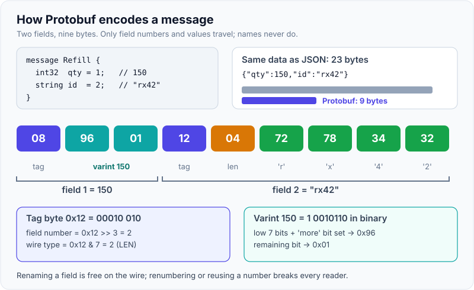
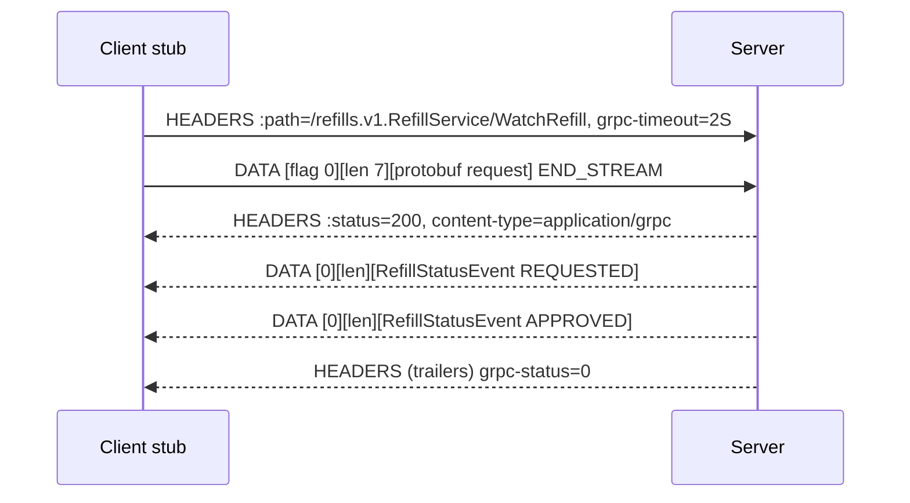

# gRPC & Protocol Buffers

!!! abstract "Key takeaways"
    - **Protocol Buffers** encode each field as a **tag** (field number + wire type) followed by its value. **Field numbers are the contract**; names never go on the wire. Never reuse or renumber a field; `reserved` the old number and name.
    - **gRPC** is RPC over **HTTP/2**: the path is `/package.Service/Method`, each message is length-prefixed, and the status travels in **trailers** (`grpc-status`). Four call types: unary, server streaming, client streaming, bidirectional.
    - **gRPC sets no deadline by default.** Always set one. Java and Go propagate the remaining budget to downstream calls, and cancellation flows down the chain too.
    - Errors are **17 status codes**, not HTTP codes. Only retry what is safe (`UNAVAILABLE` by default) and configure retries in the **service config**, which caps attempts at 5 and adds retry throttling.
    - Long-lived HTTP/2 connections need **L7 or client-side load balancing**, plus keepalive and `maxConnectionAge` so pods share the load.

## Why it matters

Most calls in a microservice estate are internal, high volume and typed on both ends. JSON spends bytes on field names and CPU on parsing, and leaves the contract in a wiki. gRPC, the open-source successor of Google's internal Stubby (2015, now CNCF), replaces that with a binary schema and generated stubs.

The API-style decision (REST vs GraphQL vs gRPC, browsers, gRPC-Web) is on [REST vs GraphQL vs gRPC](../api-design/08-rest-vs-graphql-vs-grpc.md), and HTTP/2 framing is on [HTTP/1.1 vs HTTP/2 vs HTTP/3](../networking/02-http-1-1-vs-http-2-vs-http-3.md). This page goes one level deeper: what the bytes look like, how contracts evolve, and what goes wrong in production.

## Core concepts

### Protobuf on the wire

A `.proto` file declares messages with numbered fields. The encoder writes only fields that are set, each as a **tag** then a value:

- **Tag** = `(field_number << 3) | wire_type`, written as a **varint** (7 bits per byte, the top bit says "more bytes follow"). Field numbers 1–15 fit in one tag byte, so give them to the most frequent fields.
- **Wire types**: `0` VARINT (int32, int64, bool, enum), `1` I64 (fixed64, double), `2` LEN (string, bytes, nested messages, packed repeated fields), `5` I32 (fixed32, float). Types 3 and 4 were the deprecated groups.
- **Negative numbers**: an `int32` of `-1` takes 10 bytes because it is sign-extended to 64 bits. Use `sint32`/`sint64` (ZigZag encoding) for fields that are often negative.

The protobuf docs' classic example: field 1 = `int32 150` encodes as `08 96 01`. `08` is the tag (field 1, wire type 0), and `96 01` is 150 as a varint.

{ loading=lazy }
*Names never appear on the wire, only field numbers. That is why numbers, not names, are the contract.*

A decoder that meets an unknown field number skips it (the wire type says how long it is), so old code reads new messages and vice versa. Proto3 preserves unknown fields when re-serialising (since 3.5).

### Schema evolution rules

| Change | Safe? | Why |
|---|---|---|
| Add a field with a new number | Yes | Old readers skip it; new readers see the default |
| Delete a field | Yes, **if** you `reserved` its number and name | Reuse would make old data decode as the wrong field |
| Rename a field | Wire-safe, breaks JSON and generated code | JSON mapping uses names |
| Change a field number | **No** | It is a different field |
| Change type | Only between compatible types (`int32`/`int64`/`bool`; `string`/`bytes` if UTF-8) | Others misparse silently |
| Add an enum value | Yes, keep `0` as `*_UNSPECIFIED` | Old readers keep unknown values as numbers |
| Move a field into a `oneof` | **No** | Changes presence semantics |
| `required` (proto2) | Avoid | Can never be removed safely |

Proto3 originally dropped field presence (you cannot tell `0` from "not set"); `optional` came back in 3.15 and **Editions** (`edition = "2023"`) now make presence a per-field feature. Wrap fields that need "unset" in `optional` or a wrapper type. Breaking-change detection belongs in CI: `buf breaking` compares the new `.proto` set against the main branch. The same discipline for Kafka payloads is on [schema management and Schema Registry](../kafka/10-schema-management-avro-protobuf-schema-registry-compatibilit.md).

### gRPC on HTTP/2


*Notice that HTTP status is 200 even for failures: the real outcome is `grpc-status` in the trailers, and every message carries a 5-byte prefix (compressed flag + 4-byte length).*

Each call is one HTTP/2 stream, so many calls share one TCP connection without head-of-line blocking at the HTTP layer. The four call types differ only in how many messages each side sends on the stream:

| Type | Proto | Use for |
|---|---|---|
| Unary | `rpc Get(Req) returns (Res)` | Normal request/response |
| Server streaming | `returns (stream Ev)` | Watching status, large result sets, push to a service |
| Client streaming | `rpc Upload(stream Chunk) returns (Ack)` | Uploads, batched telemetry |
| Bidirectional | `stream` both ways | Chat-like protocols, sync sessions, xDS |

Streams use **HTTP/2 flow control** (per-stream and per-connection windows), so a slow reader eventually makes `onNext` wait in the sender, the same idea as [Reactive Streams backpressure](../reactive-webflux/02-backpressure.md). In grpc-java, check `ServerCallStreamObserver.isReady()` and `setOnReadyHandler` so a stream does not buffer unbounded data in memory.

### Deadlines and cancellation

A **timeout** is a duration for one hop; a **deadline** is an absolute point by which the whole operation must finish. gRPC sends it as a `grpc-timeout` header (remaining time, so clock skew does not matter). When it passes, the client fails with `DEADLINE_EXCEEDED` and the server sees the call as `CANCELLED`. Java and Go **propagate** the incoming deadline to outgoing calls by default through `io.grpc.Context`, so a downstream service never works for a caller who has already given up.

{ loading=lazy }
*Watch the budget bar shrink at each hop: the last service gets only what is left, not a fresh timeout.*

The server still has to stop its own work: check `Context.current().isCancelled()` in long loops, or register a cancellation listener, and pass the context to database calls with a matching query timeout.

### Status codes, error details and retries

gRPC has 17 codes (0–16). The ones to know: `OK`, `CANCELLED`, `INVALID_ARGUMENT`, `DEADLINE_EXCEEDED`, `NOT_FOUND`, `ALREADY_EXISTS`, `PERMISSION_DENIED`, `RESOURCE_EXHAUSTED`, `FAILED_PRECONDITION`, `ABORTED`, `UNIMPLEMENTED`, `INTERNAL`, `UNAVAILABLE`, `UNAUTHENTICATED`. Structured details (field violations, retry info) go in a `google.rpc.Status` message serialised into the `grpc-status-details-bin` trailer.

Retries are configured per method in the **service config** (gRFC A6): `maxAttempts` (values above 5 are treated as 5), `initialBackoff`, `maxBackoff`, `backoffMultiplier` and `retryableStatusCodes`. **Retry throttling** (`maxTokens`, `tokenRatio`) stops retries when too many calls fail, which prevents a retry storm. **Hedging** sends a second copy after a delay for idempotent, latency-sensitive reads. With no policy, gRPC still makes **transparent retries** only when it knows the server application never saw the request. General retry theory is on [retries, backoff and jitter](../distributed-systems/05-retries-backoff-jitter-timeouts.md).

### Connections, keepalive and load balancing

A `ManagedChannel` is expensive and thread-safe: create one per target and reuse it. Because a client keeps one long-lived HTTP/2 connection, an L4 balancer or a Kubernetes `ClusterIP` Service pins all of a client's calls to one pod. Use an L7 proxy or mesh (Envoy, Linkerd), or client-side `round_robin` over a headless Service, and set server `maxConnectionAge` so connections are recycled; details on [load balancers](../networking/05-load-balancers-reverse-proxies-and-cdns.md). Keepalive pings detect dead connections through NATs and idle-timeout proxies, but servers reject clients that ping too often (`GOAWAY` with `too_many_pings`), so align `keepAliveTime` with the server's `permitKeepAliveTime`.

Auth tokens, tenant IDs and tracing go in **metadata** (gRPC's headers) via **interceptors**; use TLS or mTLS between services ([service-to-service auth](../spring-security-oauth2/09-service-to-service-auth.md)).

## In practice: code & configuration

=== "❌ Common mistake"
    ```java
    // New channel per call, no deadline, every error retried, internal details leaked.
    public Refill getRefill(String id) {
        ManagedChannel ch = ManagedChannelBuilder.forTarget("refills:9090").usePlaintext().build(); // TCP + HTTP/2 setup every call
        var stub = RefillServiceGrpc.newBlockingStub(ch);   // no withDeadlineAfter: may wait forever
        for (int i = 0; i < 10; i++) {                      // retries INVALID_ARGUMENT and NOT_FOUND too
            try { return stub.getRefill(GetRefillRequest.newBuilder().setRefillId(id).build()); }
            catch (StatusRuntimeException e) { /* swallow and loop */ }
        }
        throw new RuntimeException("failed");               // caller cannot tell 404 from outage
    }
    ```

=== "✅ Correct approach"
    ```java
    @Configuration
    class RefillClientConfig {
        @Bean(destroyMethod = "shutdown")
        ManagedChannel refillChannel() {
            Map<String, Object> retry = Map.of(
                "maxAttempts", 3.0, "initialBackoff", "0.1s", "maxBackoff", "1s",
                "backoffMultiplier", 2.0, "retryableStatusCodes", List.of("UNAVAILABLE"));
            Map<String, Object> serviceConfig = Map.of(
                "loadBalancingConfig", List.of(Map.of("round_robin", Map.of())), // per-call LB over all pods
                "methodConfig", List.of(Map.of(
                    "name", List.of(Map.of("service", "refills.v1.RefillService")),
                    "retryPolicy", retry)));
            return ManagedChannelBuilder
                .forTarget("dns:///refills-headless.pharmacy.svc.cluster.local:9090") // headless Service: all pod IPs
                .defaultServiceConfig(serviceConfig)
                .enableRetry()
                .keepAliveTime(60, TimeUnit.SECONDS)   // detect dead connections through proxies
                .useTransportSecurity()                // TLS (mTLS via the mesh or a TlsChannelCredentials)
                .build();                              // one channel, shared by all threads
        }
    }

    @Service
    class RefillClient {
        private final RefillServiceGrpc.RefillServiceBlockingStub stub;
        RefillClient(ManagedChannel refillChannel) { this.stub = RefillServiceGrpc.newBlockingStub(refillChannel); }

        Optional<Refill> find(String id) {
            try {
                return Optional.of(stub.withDeadlineAfter(300, TimeUnit.MILLISECONDS) // per-call deadline
                    .getRefill(GetRefillRequest.newBuilder().setRefillId(id).build()));
            } catch (StatusRuntimeException e) {
                if (e.getStatus().getCode() == Status.Code.NOT_FOUND) return Optional.empty(); // business outcome
                throw e; // DEADLINE_EXCEEDED / UNAVAILABLE surface to the caller's resilience layer
            }
        }
    }
    ```

Server side with Spring gRPC (`spring-grpc-spring-boot-starter`): a generated base class becomes a Spring bean, and errors map to status codes.

```java
@Service // any BindableService bean is registered on the gRPC server (default port 9090)
class RefillGrpcService extends RefillServiceGrpc.RefillServiceImplBase {
    private final RefillRepository repo;
    RefillGrpcService(RefillRepository repo) { this.repo = repo; }

    @Override
    public void getRefill(GetRefillRequest req, StreamObserver<Refill> out) {
        if (req.getRefillId().isBlank()) {
            out.onError(Status.INVALID_ARGUMENT.withDescription("refill_id is required").asRuntimeException());
            return;
        }
        repo.findById(req.getRefillId()).ifPresentOrElse(
            r -> { out.onNext(r.toProto()); out.onCompleted(); },          // exactly one message, then complete
            () -> out.onError(Status.NOT_FOUND.withDescription("refill not found").asRuntimeException()));
    }
}
```

## Real-world usage

- **Kubernetes** (CRI, CSI drivers), **etcd v3** and **Envoy's xDS** configuration streams all use gRPC; Netflix, Square and Dropbox have written about moving internal RPC to it.
- **Banking and healthcare:** internal high-volume calls (pricing, eligibility checks, fraud scoring) are typical gRPC candidates; partner-facing APIs usually stay REST with OpenAPI for auditability and tooling.

## Trade-offs & production gotchas

| Option | Pros | Cons | Use when |
|---|---|---|---|
| gRPC + Protobuf | Compact, fast, typed codegen, streaming, deadlines | Binary debugging, needs L7 LB, browsers need a proxy | Internal service-to-service, streaming, polyglot |
| REST + JSON | Universal, cacheable, human-readable | Bigger payloads, contract drift without OpenAPI | Public/partner APIs, browsers |
| Protobuf over Kafka | Same schema discipline for events | Needs Schema Registry | Async events between the same services |

!!! warning "Gotchas"
    - **No default deadline.** One slow dependency then holds threads and connections forever.
    - **Reusing a field number** silently corrupts data for old readers. Always `reserved`.
    - **Default max inbound message size is 4 MB.** Stream large results instead of raising the limit.
    - **Retrying non-idempotent calls** (`CreatePayment`) on `DEADLINE_EXCEEDED` can double-execute: the server may have finished. Use [idempotency keys](../api-design/05-idempotency-keys-and-safe-retries.md).
    - **Unbounded streams:** ignoring `isReady()` buffers messages in memory until the pod runs out of heap.

## How this connects to my experience

- **Where I used it:** gRPC is not on the resume; position it as transferable knowledge. The closest fit is the **GraphQL Consumer Service** on OptumRx Meteor, the "integration layer between 5 upstream systems": in an interview, explain that the GraphQL edge could call internal services over gRPC, as in the common "GraphQL outside, gRPC inside" design. Whether any upstream used gRPC is not stated *[confirm]*.
- **Talking points:**
    - Schema evolution is the same discipline as Kafka event contracts in the Kafka-based workflows: additive changes, never reuse identifiers, check compatibility in CI. *[confirm: whether you used Avro/Protobuf with a Schema Registry]*
    - Deadlines and retries map onto what the aggregation layer needs anyway: a budget per upstream, retry only transient failures, fail fast and degrade.
- **Likely follow-up chain:** "Why gRPC over REST internally?" → payload size, codegen, streaming, deadlines → "How do you evolve the contract?" → additive fields, `reserved`, `buf breaking` → "One pod gets all the traffic, why?" → L4 vs L7, headless Service + `round_robin`, `maxConnectionAge`.

## Interview questions

### Fundamentals

??? question "Q1. How does Protobuf encode a message, and why is it smaller than JSON?"
    **Answer:** Each set field is written as a tag, `(field_number << 3) | wire_type`, followed by the value. Integers use varints (7 bits per byte), strings and nested messages are length-prefixed. Field names and punctuation never go on the wire and unset fields are omitted, so messages are typically several times smaller than JSON and cheaper to parse.

    **Interviewer listens for:** tag = number + wire type, varints, length-prefix, no names on the wire.

    **Common wrong answer:** "It compresses the JSON." Protobuf is a different encoding, not compression.

??? question "Q2. What are the four gRPC call types?"
    **Answer:** Unary (one request, one response), server streaming (one request, many responses), client streaming (many requests, one response), and bidirectional streaming (both sides send independently on one HTTP/2 stream). All share one connection through HTTP/2 multiplexing, and streams are flow-controlled.

    **Interviewer listens for:** a use case for each, one call = one HTTP/2 stream, flow control.

    **Common wrong answer:** "Streaming uses WebSockets underneath."

### Intermediate

??? question "Q3. Which Protobuf schema changes are safe?"
    **Answer:** Adding a field with a new number, deleting a field if you reserve its number and name, adding enum values (with `0` as `UNSPECIFIED`), and switching between wire-compatible types like `int32` and `int64`. Unsafe: changing or reusing a field number, changing to an incompatible type, moving an existing field into a `oneof`, adding `required`. Renaming is wire-safe but breaks JSON mapping and generated code. Enforce with `buf breaking` in CI.

    **Interviewer listens for:** numbers are the contract, `reserved`, CI check, presence nuances.

    **Common wrong answer:** "Bump the package to v2 for every change."

??? question "Q4. What is the difference between a timeout and a deadline in gRPC?"
    **Answer:** A timeout is a per-hop duration; a deadline is the absolute time by which the whole call tree must finish. gRPC sends the remaining time in `grpc-timeout`, Java and Go propagate it to downstream calls via `Context`, and when it expires the client gets `DEADLINE_EXCEEDED` while servers see `CANCELLED`. gRPC has no default deadline, so you must set one.

    **Interviewer listens for:** propagation, remaining budget, cancellation downstream, no default.

    **Common wrong answer:** "Each service sets its own 30 s timeout." Downstream work then continues after the caller gave up.

??? question "Q5. Which gRPC errors should a client retry?"
    **Answer:** `UNAVAILABLE` is the standard retryable code (connection or server not ready). `RESOURCE_EXHAUSTED` and `ABORTED` sometimes, with backoff. `DEADLINE_EXCEEDED` only if the method is idempotent, because the server may have completed it. Never `INVALID_ARGUMENT`, `NOT_FOUND`, `PERMISSION_DENIED` or `UNAUTHENTICATED`. Configure it in the service config with backoff, at most 5 attempts, and retry throttling.

    **Interviewer listens for:** idempotency, retry throttling, service config rather than hand loops.

    **Common wrong answer:** "Retry everything three times."

### Senior

??? question "Q6. Your gRPC service has 10 pods but two of them take almost all the traffic. Why?"
    **Answer:** gRPC keeps long-lived HTTP/2 connections and multiplexes every call over them. A Kubernetes `ClusterIP` Service balances at L4, per connection, so each client stays on the pod it first reached and new pods get nothing. Fix with per-request L7 balancing (Envoy, Linkerd, an ALB gRPC target group) or client-side `round_robin` over a headless Service, and set `maxConnectionAge` so connections are recycled.

    **Interviewer listens for:** connection vs request balancing, headless Service, mesh, connection age.

    **Common wrong answer:** "Increase replicas."

??? question "Q7. How do you stop a server-streaming RPC from running out of memory with a slow client?"
    **Answer:** Respect HTTP/2 flow control. In grpc-java, cast to `ServerCallStreamObserver`, send only while `isReady()` is true, and resume in `setOnReadyHandler`. Read from the source in pages, not all at once. Also handle `setOnCancelHandler` to stop when the client disconnects, and set a maximum stream duration.

    **Interviewer listens for:** `isReady`, on-ready handler, cancellation, bounded source.

    **Common wrong answer:** "Call `onNext` in a loop; gRPC handles it." It buffers.

### Scenario-based

??? question "Q8. A partner team asks to rename `member_id` to `subscriber_id` and change it from `int64` to `string`. How do you handle it?"
    **Answer:** Not in place: changing type breaks old readers. Add `string subscriber_id = 7;`, write both fields during a migration window, move readers to the new field, then remove `member_id` and `reserved 3; reserved "member_id";`. If the semantics change too much, publish a `v2` package and run both services side by side. Protect it with `buf breaking` and consumer contract tests.

    **Interviewer listens for:** expand and contract, reserved, versioned package as the fallback.

    **Common wrong answer:** "Change it and redeploy everything at once."

## Cheat sheet

| Concept | Remember |
|---|---|
| Tag | `(field_number << 3) \| wire_type`, varint |
| Wire types | 0 varint, 1 I64, 2 LEN, 5 I32 |
| Field numbers | 1–15 one byte; 19000–19999 reserved; never reuse |
| Negative ints | `sint32`/`sint64` (ZigZag) |
| gRPC path | `/package.Service/Method`, `application/grpc` |
| Framing | 1-byte compressed flag + 4-byte length |
| Status | `grpc-status` in trailers; 17 codes |
| Deadline | None by default; `withDeadlineAfter`; propagated in Java/Go |
| Retries | Service config, `maxAttempts` ≤ 5, throttling, `UNAVAILABLE` |
| Max message | 4 MB inbound by default |
| LB | L7 / client-side `round_robin`, `maxConnectionAge` |

## Sources

1. [Protocol Buffers: Encoding](https://protobuf.dev/programming-guides/encoding/): tags, wire types, varints, the `08 96 01` example, ZigZag.
2. [Protocol Buffers: Proto Best Practices (dos and don'ts)](https://protobuf.dev/best-practices/dos-donts/): reserved numbers, type changes, enum zero values.
3. [Protocol Buffers: Field presence](https://protobuf.dev/programming-guides/field_presence/): proto3 `optional`, editions.
4. [gRPC over HTTP/2 protocol](https://github.com/grpc/grpc/blob/master/doc/PROTOCOL-HTTP2.md): path, length-prefixed messages, `grpc-timeout`, trailers.
5. [gRPC: Deadlines](https://grpc.io/docs/guides/deadlines/): no default deadline, propagation, `DEADLINE_EXCEEDED` and `CANCELLED`.
6. [gRPC: Retry](https://grpc.io/docs/guides/retry/) and [gRFC A6](https://github.com/grpc/proposal/blob/master/A6-client-retries.md): retry policy, throttling, transparent retries, 5-attempt cap.
7. [gRPC: Status codes](https://grpc.io/docs/guides/status-codes/): the 17 codes and when the library generates them.
8. [gRPC: Keepalive](https://grpc.io/docs/guides/keepalive/): client pings, `permitKeepAliveTime`, `too_many_pings`.
9. [Spring gRPC reference: server](https://docs.spring.io/spring-grpc/reference/server.html): `BindableService` beans, interceptors, health.
10. [Buf: breaking change detection](https://buf.build/docs/breaking/): compatibility checks in CI.
