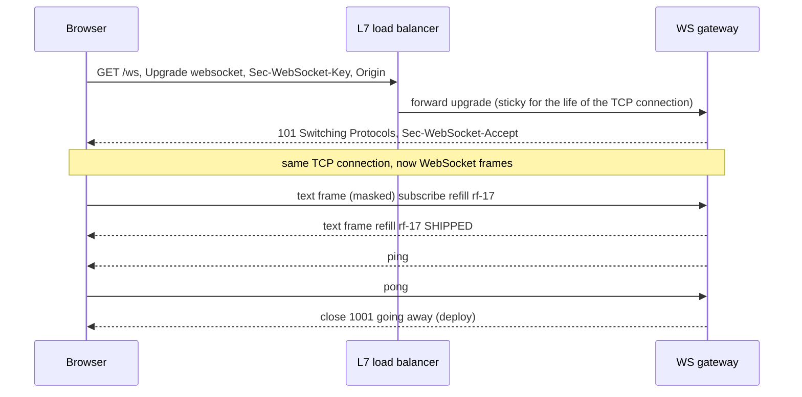
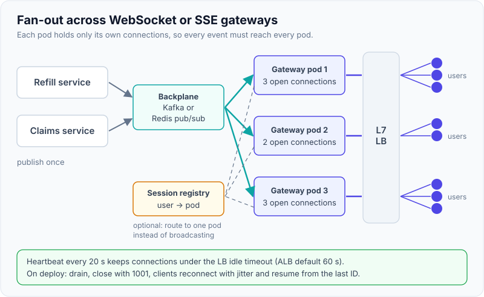

# WebSockets vs SSE vs Long Polling

!!! abstract "Key takeaways"
    - **Long polling**: the client sends a request, the server holds it until there is data or a timeout, then the client immediately asks again. Works everywhere, costs a request per message.
    - **Server-Sent Events (SSE)**: one long HTTP response of type `text/event-stream`, **server to client only**, UTF-8 text. The browser's `EventSource` reconnects by itself and sends `Last-Event-ID` so the server can resume.
    - **WebSocket** (RFC 6455): an HTTP `Upgrade` turns the connection into a **full-duplex** message channel, text or binary. You build reconnection, resume and heartbeats yourself.
    - Pick by direction and frequency: server-only updates → SSE; frequent two-way messages (chat, collaboration, games) → WebSocket; rare updates or hostile networks → long polling or plain polling.
    - The hard part is **operating long-lived connections**: idle timeouts, heartbeats, fan-out across instances, auth on the handshake, draining on deploy and reconnect storms.

## Why it matters

HTTP is request/response: the server cannot speak first. Notifications, dashboards, chat and LLM token streaming all need server push. Today there are two standards, SSE and WebSocket (RFC 6455, 2011), plus long polling as the universal fallback.

Interviewers use this to check that you can match the transport to the requirement instead of reaching for WebSockets by default, and that you know what changes when connections last hours instead of milliseconds. The chat system design is on [case studies](../system-design/10-case-studies-url-shortener-rate-limiter-notification-system.md), GraphQL subscriptions on [GraphQL fundamentals](../graphql/01-graphql-fundamentals-vs-rest-schema-types-queries-mutations.md), and per-client backpressure on [backpressure](../reactive-webflux/02-backpressure.md).

## Core concepts

### Long polling

The client sends `GET /updates?since=42`. If nothing is new, the server parks the request (Spring's `DeferredResult`, or an async servlet) for up to ~30 seconds, then answers `204` or the new data. The client processes it and immediately sends the next request with the latest cursor. Messages arriving between responses wait for the next request, so the cursor is essential to avoid losing them. Cost: one HTTP request, headers and all, per batch.

### Server-Sent Events

The server answers once with `Content-Type: text/event-stream` and never ends the response. Each event is a few `field: value` lines followed by a blank line:

```text
: keep-alive comment, ignored by the browser

id: 1043
event: refill-status
retry: 5000
data: {"refillId":"rf-17","status":"SHIPPED"}

```

`data` is the payload (several `data:` lines are joined with newlines), `event` selects the listener, `id` sets the last event ID and `retry` the reconnection delay in milliseconds. If the connection drops, `EventSource` reconnects automatically and sends `Last-Event-ID: 1043`, so a server that keeps a short replay buffer can resume without gaps. Limits: one direction only, text only, `GET` only, and the native `EventSource` cannot set custom headers (use cookies, or a `fetch`-based client for a bearer token). Over HTTP/1.1 a browser allows only **6 connections per domain**, shared across tabs; over HTTP/2 the streams share one connection (about 100 concurrent streams by default).

### WebSocket


*Notice that the handshake is ordinary HTTP, so it passes through proxies and carries cookies and `Origin`; after `101` no more HTTP is spoken on that connection.*

The client sends a random `Sec-WebSocket-Key`; the server proves it understood by returning `Sec-WebSocket-Accept` = base64(SHA-1(key + a fixed GUID)). After that, data moves in small **frames**: opcode text (`0x1`), binary (`0x2`), close (`0x8`), ping (`0x9`) and pong (`0xA`). Frames from browser to server are **masked** to stop cache-poisoning attacks on intermediaries. Close codes: `1000` normal, `1001` going away, `1008` policy violation, `1011` server error; `1006` (abnormal, no close frame) is what clients see when the network drops. RFC 8441 runs WebSockets over HTTP/2 streams.

WebSocket gives you a pipe, not a protocol. You define message types, acknowledgements, resume after reconnect, and often a subprotocol (`Sec-WebSocket-Protocol`: STOMP, `graphql-transport-ws`, MQTT).

{ loading=lazy }
*Count the blue request arrows: long polling pays a request per batch, SSE and WebSocket pay one handshake.*

### Side by side

| | Long polling | SSE | WebSocket |
|---|---|---|---|
| Direction | Server → client (client sends normal requests) | Server → client | Both, full-duplex |
| Payload | Any HTTP body | UTF-8 text | Text or binary |
| Reconnect and resume | Natural: each request carries a cursor | Built in: `retry`, `Last-Event-ID` | Your code |
| Works through proxies, firewalls | Best | Good (it is HTTP); watch buffering | Usually; some corporate proxies break `Upgrade` |
| Overhead per message | Full HTTP request + response | A few bytes | 2–14 bytes of frame header |
| Server cost | Parked request per client | Open response per client | Open socket per client |
| Spring | `DeferredResult` | `SseEmitter` (MVC), `Flux<ServerSentEvent<T>>` (WebFlux) | `WebSocketHandler`, STOMP with `@MessageMapping` |
| Typical use | Legacy clients, rare events | Notifications, dashboards, LLM token streams | Chat, collaborative editing, games, trading UIs |

### Running long-lived connections at scale

- **Fan-out across instances.** A user is connected to one gateway pod, but the event may be produced anywhere. Publish events to a backplane (Redis pub/sub, Kafka, NATS); each gateway subscribes and pushes to its local connections, or a **session registry** (user → gateway) routes messages directly. See [Redis pub/sub](../redis-caching/07-distributed-locks-rate-limiting-and-pub-sub-with-redis.md).
- **Idle timeouts and heartbeats.** Load balancers and proxies close silent connections (AWS ALB's default idle timeout is 60 s). Send an SSE comment or WebSocket ping every 20–30 s, and detect dead clients by missing pongs.
- **Load balancing.** A WebSocket stays on the pod that accepted it, so you do not need sticky sessions for the socket itself; you do need them for long-polling fallbacks such as SockJS. L4 balancing pins long connections, so new pods get no existing clients ([load balancers](../networking/05-load-balancers-reverse-proxies-and-cdns.md)).
- **Deploys and reconnect storms.** On shutdown send close `1001` (or end the SSE stream) and let clients reconnect with **jittered exponential backoff**, otherwise every client reconnects in the same second.
- **Proxy buffering.** NGINX buffers responses by default, delaying SSE: send `X-Accel-Buffering: no` or set `proxy_buffering off`.
- **Slow consumers.** A broadcast cannot wait for one slow client. Bound each connection's send queue and drop, coalesce or disconnect when it fills.

{ loading=lazy }
*An event published once reaches every gateway; each gateway delivers only to the sockets it holds.*

### Security

- **Authenticate the handshake.** The browser `WebSocket` API cannot set an `Authorization` header. Use the session cookie, a short-lived single-use ticket in the query string (fetched over an authenticated REST call), or a token in the first message, as `graphql-ws` does. Keep tokens out of URLs that get logged.
- **Check `Origin`.** A cookie-authenticated WebSocket without an `Origin` check is open to **cross-site WebSocket hijacking**: CORS does not apply to WebSockets ([CORS](../application-security/03-cors-explained.md)).
- **Tokens expire mid-connection.** Close with `1008` or require re-authentication when the token expires, and authorise every subscription, not just the connection.
- Use `wss://` and set message-size and rate limits per connection.

## In practice: code & configuration

=== "❌ Common mistake"
    ```java
    // Spring MVC: one SseEmitter per client kept in a list, sent from one thread.
    private final List<SseEmitter> emitters = new ArrayList<>(); // not thread-safe, never cleaned up

    @GetMapping("/refills/stream")
    SseEmitter stream() {
        SseEmitter e = new SseEmitter();       // default timeout: the server's async timeout (often 30 s)
        emitters.add(e);                        // dead clients stay in the list forever
        return e;
    }

    @Scheduled(fixedRate = 1000)
    void push() throws IOException {
        for (SseEmitter e : emitters) e.send(latestStatus()); // no event id: clients cannot resume
    }                                                          // one IOException stops the whole loop
    ```

=== "✅ Correct approach"
    ```java
    // Spring WebFlux: one shared hot stream, per-client resume, heartbeats and bounded buffering.
    @RestController
    class RefillEventsController {
        private final RefillEventBus bus;           // backed by Redis pub/sub or Kafka; hot Flux of events
        private final RefillEventStore store;       // short replay window (e.g. last 15 minutes)

        RefillEventsController(RefillEventBus bus, RefillEventStore store) { this.bus = bus; this.store = store; }

        @GetMapping(path = "/refills/stream", produces = MediaType.TEXT_EVENT_STREAM_VALUE)
        Flux<ServerSentEvent<RefillEvent>> stream(
                @RequestHeader(name = "Last-Event-ID", required = false) Long lastId,
                @AuthenticationPrincipal Jwt user) {
            String memberId = user.getSubject();                   // authorise per member, not per connection only
            Flux<RefillEvent> missed = lastId == null ? Flux.empty() : store.since(memberId, lastId); // resume
            Flux<RefillEvent> live = bus.events().filter(ev -> ev.memberId().equals(memberId))
                .onBackpressureLatest();                           // slow client gets the newest, not everything
            Flux<ServerSentEvent<RefillEvent>> data = Flux.concat(missed, live)
                .map(ev -> ServerSentEvent.builder(ev).id(String.valueOf(ev.seq())).event("refill-status").build());
            Flux<ServerSentEvent<RefillEvent>> heartbeat = Flux.interval(Duration.ofSeconds(20))
                .map(i -> ServerSentEvent.<RefillEvent>builder().comment("ping").build()); // beats the LB idle timeout
            return Flux.merge(data, heartbeat);                    // cancelled automatically when the client leaves
        }
    }
    ```

The browser side, with resume handled by `EventSource`:

```ts
const source = new EventSource("/refills/stream", { withCredentials: true }); // cookie auth
source.addEventListener("refill-status", (e: MessageEvent<string>) => {
  const ev = JSON.parse(e.data) as { refillId: string; status: string };
  queryClient.setQueryData(["refill", ev.refillId], (old: Refill | undefined) =>
    old ? { ...old, status: ev.status } : old);               // patch the React Query cache in place
});
source.onerror = () => console.warn("SSE dropped; browser will retry and send Last-Event-ID");
```

## Real-world usage

- **LLM APIs** (OpenAI, Anthropic and others) stream tokens with SSE: one-way, text, plain HTTP through every proxy.
- **Slack and Discord** use WebSocket gateways for two-way messaging, with clients reconnecting and resuming from a sequence number.
- **LinkedIn** described serving instant messaging and presence to hundreds of thousands of persistent connections per machine with SSE on Play and Akka (2016), chosen because it is plain HTTP and works on more networks.
- **Banking and healthcare:** trading and market-data screens use WebSockets; order or claim-status pages usually only need SSE, or polling every 30–60 s when freshness is not critical.

## Trade-offs & production gotchas

| Option | Pros | Cons | Use when |
|---|---|---|---|
| Short polling | Trivial, cacheable, stateless | Wasteful, latency = interval | Updates every minute or more is fine |
| Long polling | Works everywhere, natural resume | Request per batch, parked requests | Fallback, rare events |
| SSE | Simple, auto-reconnect and resume, plain HTTP | One-way, text only, 6-connection limit on HTTP/1.1 | Notifications, feeds, token streaming |
| WebSocket | Full-duplex, binary, low overhead | You build resume and heartbeats, proxies, auth quirks | Chat, collaboration, games, trading |

!!! warning "Gotchas"
    - **Silent disconnects:** without heartbeats, a dropped mobile client looks connected for minutes and its buffer grows.
    - **Reconnect storms** after a deploy or LB failover take down the auth service. Jitter the backoff.
    - **HTTP/1.1 SSE limit:** six tabs of your app exhaust the browser's per-domain connections. Serve over HTTP/2, or share one connection across tabs with a `SharedWorker` or `BroadcastChannel`.
    - **Per-pod limits:** file descriptors and memory per socket. Load-test connection count, not just requests per second.

## How this connects to my experience

- **Where I used it:** Not stated on the resume; position as transferable knowledge. The closest fits on OptumRx Meteor are the **ReactJS application** and the **GraphQL Consumer Service**: GraphQL subscriptions run over WebSocket (`graphql-transport-ws`) or SSE, and Kafka-based workflows are the natural backplane for pushing status changes to the UI. Whether the app used subscriptions, SSE or polling is unknown *[confirm]*.
- **Talking points:**
    - For refill or order status in a healthcare app, SSE is usually enough: updates are one-way and infrequent, it works through corporate proxies, and React Query can patch its cache on each event.
    - Fan-out pattern: Kafka event → each gateway instance consumes (own consumer group per instance, or Redis pub/sub) → push to local connections.
    - Security: PingFederate-issued OAuth2 tokens on the handshake, `Origin` checks, re-auth on expiry.
- **Likely follow-up chain:** "WebSocket or SSE for notifications?" → SSE, with reasons → "How does it scale to 750K users?" → connection math, gateways, backplane, heartbeats → "What happens on deploy?" → drain, close `1001`, jittered reconnect, `Last-Event-ID` resume.

## Interview questions

### Fundamentals

??? question "Q1. Compare long polling, SSE and WebSockets."
    **Answer:** Long polling keeps a normal request open until data arrives, then the client re-requests; it works everywhere but costs a request per batch. SSE is one long `text/event-stream` response, server to client only, text only, with automatic reconnection and `Last-Event-ID` resume. WebSocket upgrades an HTTP connection to a full-duplex framed channel for text or binary in both directions, and you implement reconnection and resume yourself.

    **Interviewer listens for:** direction, reconnection, overhead, a use case for each.

    **Common wrong answer:** "SSE is old, WebSocket replaced it."

??? question "Q2. How does the WebSocket handshake work?"
    **Answer:** The client sends an HTTP GET with `Upgrade: websocket`, `Connection: Upgrade`, `Sec-WebSocket-Key` and `Sec-WebSocket-Version: 13` (plus cookies and `Origin`). The server replies `101 Switching Protocols` with `Sec-WebSocket-Accept`, the base64 SHA-1 of the key plus a fixed GUID. From then on the TCP connection carries WebSocket frames; client frames are masked.

    **Interviewer listens for:** it starts as HTTP, 101, key/accept, masking.

    **Common wrong answer:** "It is a separate protocol on its own port."

### Intermediate

??? question "Q3. When would you choose SSE over WebSocket?"
    **Answer:** When data flows mainly server to client: notifications, dashboards, progress, LLM token streams. SSE is plain HTTP (works through proxies, HTTP/2 multiplexing, standard auth with cookies), and gives reconnection and resume for free. Client-to-server messages go over normal HTTP calls. Choose WebSocket for frequent two-way messages, binary data, or low-latency interaction.

    **Interviewer listens for:** direction and frequency drive the choice, built-in resume, operational simplicity.

    **Common wrong answer:** "SSE can't scale."

??? question "Q4. Why do long-lived connections drop after exactly 60 seconds of silence?"
    **Answer:** A load balancer or proxy idle timeout; AWS ALB defaults to 60 seconds. Fix with application heartbeats shorter than the timeout (SSE comment lines, WebSocket ping/pong every 20–30 s), and raise the timeout where appropriate. Heartbeats also detect dead clients on the server.

    **Interviewer listens for:** idle timeout, heartbeat interval below it, dead-peer detection both ways.

    **Common wrong answer:** "TCP keepalive handles it." Its default interval is hours and proxies ignore it.

??? question "Q5. How do you authenticate a browser WebSocket?"
    **Answer:** The browser API cannot set an `Authorization` header. Options: the session cookie with an `Origin` check (against cross-site WebSocket hijacking), a short-lived single-use ticket obtained over authenticated REST and passed in the URL, or a token in the first message validated before any subscription (the `graphql-ws` `connection_init` pattern). Then authorise each subscription and handle token expiry on the open connection.

    **Interviewer listens for:** header limitation, Origin check, ticket pattern, expiry handling.

    **Common wrong answer:** "CORS protects it." CORS does not apply to WebSockets.

### Senior

??? question "Q6. How do you scale WebSocket notifications to hundreds of thousands of users?"
    **Answer:** Separate stateless gateway pods that only hold connections. Producers publish events to a backplane (Kafka, Redis pub/sub); each gateway receives them and pushes to its local connections, or a session registry routes to the right gateway. Size by connections per pod (memory and file descriptors), heartbeat through LB idle timeouts, bound per-connection send buffers, drain gracefully on deploy and make clients reconnect with jittered backoff and resume from a sequence number.

    **Interviewer listens for:** backplane, connection-count capacity planning, resume, reconnect storms.

    **Common wrong answer:** "Sticky sessions solve it." They only route the connection; events still originate elsewhere.

??? question "Q7. A client reconnects after a network drop. How do you make sure it misses nothing?"
    **Answer:** Give each event a monotonically increasing ID per stream. With SSE, send `id:` and read `Last-Event-ID` on reconnect; with WebSocket, the client sends its last sequence number in a resume message. The server replays from a bounded store (Redis stream, Kafka offset, DB table) and, if the gap is too old, tells the client to do a full refresh via REST.

    **Interviewer listens for:** sequence IDs, replay window, fallback to full sync.

    **Common wrong answer:** "TCP guarantees delivery." Not across reconnects.

### Scenario-based

??? question "Q8. After every deploy the auth service falls over. You recently moved the app to WebSockets. What is happening?"
    **Answer:** A reconnect storm: closing all sockets at once makes every client reconnect, and re-authenticate, in the same second. Fix by rolling pods slowly with connection draining, closing with `1001` and a server-suggested delay, jittered exponential backoff in clients, caching auth on reconnect with short-lived resume tickets, and rate limiting the handshake endpoint.

    **Interviewer listens for:** thundering herd, jitter, draining, protect dependencies.

    **Common wrong answer:** "Scale up the auth service."

## Cheat sheet

| Concept | Remember |
|---|---|
| SSE type | `text/event-stream`; fields `data`, `event`, `id`, `retry`; `:` comment |
| SSE resume | Browser sends `Last-Event-ID` |
| SSE limit | 6 connections per domain on HTTP/1.1; ~100 streams on HTTP/2 |
| WS handshake | `Upgrade: websocket` → `101`, `Sec-WebSocket-Accept` |
| WS opcodes | text 0x1, binary 0x2, close 0x8, ping 0x9, pong 0xA |
| Close codes | 1000 normal, 1001 going away, 1006 abnormal, 1008 policy |
| Heartbeat | Every 20–30 s; ALB idle timeout 60 s default |
| Scale | Gateways + backplane + session registry |
| Security | Origin check, ticket or first-message auth, `wss://` |
| Spring | `DeferredResult`, `SseEmitter`, `Flux<ServerSentEvent>`, `WebSocketHandler`/STOMP |

## Sources

1. [RFC 6455: The WebSocket Protocol](https://www.rfc-editor.org/rfc/rfc6455): handshake, framing, masking, close codes.
2. [RFC 8441: Bootstrapping WebSockets with HTTP/2](https://www.rfc-editor.org/rfc/rfc8441): WebSocket over HTTP/2.
3. [HTML Living Standard: Server-sent events](https://html.spec.whatwg.org/multipage/server-sent-events.html): event stream format, reconnection, `Last-Event-ID`.
4. [MDN: Using server-sent events](https://developer.mozilla.org/en-US/docs/Web/API/Server-sent_events/Using_server-sent_events): fields, comments for keep-alive, 6-connection limit.
5. [MDN: WebSocket API](https://developer.mozilla.org/en-US/docs/Web/API/WebSockets_API): browser API and its limits.
6. [Spring Framework: WebSockets](https://docs.spring.io/spring-framework/reference/web/websocket.html) and [SSE in WebFlux](https://docs.spring.io/spring-framework/reference/web/webflux/reactive-spring.html): `WebSocketHandler`, STOMP, `ServerSentEvent`.
7. [AWS: Application Load Balancer idle timeout](https://docs.aws.amazon.com/elasticloadbalancing/latest/application/edit-load-balancer-attributes.html#connection-idle-timeout): 60-second default.
8. [OWASP: WebSocket Security Cheat Sheet](https://cheatsheetseries.owasp.org/cheatsheets/WebSocket_Security_Cheat_Sheet.html): Origin checks, authentication, cross-site WebSocket hijacking.
9. [LinkedIn Engineering: Instant messaging at LinkedIn, scaling to hundreds of thousands of persistent connections on one machine](https://engineering.linkedin.com/blog/2016/10/instant-messaging-at-linkedin--scaling-to-hundreds-of-thousands-): SSE at scale on Akka.
