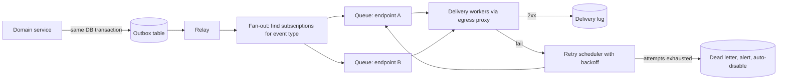

# Webhooks Design

!!! abstract "Key takeaways"
    - A webhook is an **HTTP POST from your system to a URL a customer registered** when an event happens. It is at-least-once messaging over the public internet to endpoints you do not control.
    - Promise **at-least-once, unordered** delivery, and give every event a **stable ID** so receivers can deduplicate. Never promise exactly-once or ordering.
    - **Sign every request** (HMAC-SHA256 over id + timestamp + raw body, as in the Standard Webhooks spec), and support **two active secrets** so customers can rotate without downtime.
    - Deliver from a **durable queue** fed by an **outbox**, with short timeouts, **exponential backoff with jitter over about 3 days**, and **per-endpoint isolation** so one slow customer cannot delay everyone else.
    - Treat customer URLs as hostile: **SSRF protection** (block private and metadata IPs, re-check after DNS resolution, no redirects), plus delivery logs, manual replay, and auto-disable with notification.

## Why it matters

Polling for changes wastes capacity and adds latency; webhooks invert it so the provider calls the client. Most SaaS platforms use them, and in enterprises they are how partners hear about claims, payments or prescriptions.

Interviews come at it from two sides. "Build a receiver" is covered in depth, with signature verification, inbox table and deduplication code, on [webhook receivers](../fde-practical-coding/03-webhooks-signature-verification-idempotent-consumers-duplica.md). This page is the other side: **"design a webhook delivery system"**, a common system design question for platform and integration roles.

## Core concepts

### The contract you publish

| Decision | Recommendation |
|---|---|
| Delivery guarantee | At least once. Duplicates happen (timeouts after the receiver committed, retries). |
| Ordering | Not guaranteed. Include a timestamp and a resource version so receivers can discard stale updates. |
| Success | Any `2xx` within the timeout. `3xx` is a failure: do not follow redirects. `410 Gone` means "stop sending": disable the endpoint. |
| Timeout | Short: GitHub expects a response within 10 s; Standard Webhooks suggests 15–30 s. Receivers should acknowledge first and process asynchronously. |
| Identity | Stable event ID, the same on every retry (`webhook-id`, Stripe `evt_…`, GitHub `X-GitHub-Delivery`). |
| Payload | `{type, timestamp, data}` with dotted event types (`refill.shipped`). |
| Versioning | Pin the payload schema to the API version the endpoint was created with; let customers upgrade per endpoint. |

### Thin vs fat payloads

A **fat (snapshot) payload** carries the full object, so receivers rarely call back. A **thin payload** carries only the type and IDs; the receiver fetches the current state over the authenticated API. Thin events avoid leaking sensitive data to a misconfigured URL, cannot be stale (the receiver reads the latest state, which also solves ordering), and survive schema changes. The cost is an extra API call per event. Stripe now recommends thin events for new integrations. In healthcare, thin payloads keep PHI out of webhook bodies and logs, and every fetch is authorised and audited.

### Delivery architecture


*Notice that the event is written in the same transaction as the business change (outbox), and that each endpoint has its own queue, so a slow or failing customer only delays itself.*

- **Outbox.** Publishing the webhook from inside the request ("save, then POST") either loses events on a crash or sends events for rolled-back changes. Write an outbox row in the same transaction; a relay (polling or CDC with Debezium) publishes it. See [saga and outbox](../microservices/07-distributed-transactions-saga-outbox-pattern.md).
- **Fan-out.** One event becomes one **delivery** per matching subscription; each delivery has its own attempt count and status.
- **Per-endpoint isolation.** A shared FIFO lets one endpoint that times out after 30 s block workers for everyone. Use per-endpoint queues or partitions, per-endpoint concurrency limits, and a circuit breaker that pauses an endpoint after consecutive failures ([bulkheads](../microservices/06-resilience-circuit-breaker-retry-bulkhead-timeout-rate-limit.md)).
- **Rate limits.** Respect `429` and `Retry-After`; let customers set a maximum rate per endpoint.

### Retries and backoff

Retry on connection errors, timeouts, `5xx`, `429` and other non-`2xx` responses, with exponential backoff and jitter. The Standard Webhooks schedule is a good default: immediately, 5 s, 5 min, 30 min, 2 h, 5 h, 10 h, 14 h, 20 h, 24 h, about 3 days in total. Stripe also retries for up to three days in live mode; GitHub does not retry automatically and offers manual redelivery instead.

{ loading=lazy }
*Early retries catch blips; later ones ride out a deploy or a weekend outage. After about three days, a human is needed.*

After the last attempt, mark the delivery failed, keep it for replay, and if an endpoint fails consistently for days, **disable it and email the owner**. A dashboard with per-delivery request, response and latency, plus **"resend"** and **"replay since time T"**, turns most support tickets into self-service. Offer an **events list API** (`GET /events?created_after=…`) so customers can reconcile what they missed.

### Signing and secret rotation

Sign `"{id}.{timestamp}.{raw body}"` with HMAC-SHA256 and a per-endpoint secret, and send `webhook-id`, `webhook-timestamp` and `webhook-signature: v1,<base64>`. The timestamp inside the signature lets receivers reject replays older than about 5 minutes. For rotation, sign with **both** the old and new secret for a grace period (Standard Webhooks puts several space-separated signatures in one header; Stripe keeps the old secret valid for up to 24 h). Asymmetric signatures (ed25519, `v1a`) let receivers verify with a public key, so the provider never shares a secret. mTLS and published source IP ranges are extra layers, not substitutes. Receiver-side verification is on the [receiver page](../fde-practical-coding/03-webhooks-signature-verification-idempotent-consumers-duplica.md), HMAC itself on [hashing, MACs and signatures](../cryptography-key-management/01-symmetric-vs-asymmetric-encryption-hashing-mac-digital-signa.md), and the overlap-window idea on [key rotation without downtime](../cryptography-key-management/06-key-rotation-strategies-without-downtime.md).

### SSRF: customer URLs are attacker input

Your delivery workers make HTTP requests to arbitrary URLs from inside your network. Without controls, a customer registers `http://169.254.169.254/latest/meta-data/` or `http://payments.internal/admin` and reads the responses through your delivery log.

- Require `https://` and validate on registration **and** at send time.
- Resolve DNS, then block private, loopback, link-local and metadata ranges on the **resolved IP**, and connect to that same IP (prevents DNS rebinding).
- Do not follow redirects; do not show full response bodies to customers (truncate and sanitise).
- Best: send all deliveries through an **egress proxy** (such as Stripe's open-source Smokescreen) in an isolated subnet with no route to internal services.

{ loading=lazy }
*One failing endpoint backs off in its own lane; the others never notice.*

## In practice: code & configuration

=== "❌ Common mistake"
    ```java
    @Transactional
    public Refill ship(String refillId) {
        Refill r = repo.markShipped(refillId);
        for (Subscription s : subscriptions.findByEvent("refill.shipped")) {
            restClient.post().uri(s.url())              // inside the transaction: slow customer = long DB lock
                .body(r)                                // fat payload with PHI; no id, no signature
                .retrieve().toBodilessEntity();         // follows redirects, no timeout, no SSRF check
        }                                               // exception rolls back the shipment; crash loses events
        return r;
    }
    ```

=== "✅ Correct approach"
    ```java
    // 1. Business change and outbox row commit together.
    @Transactional
    public Refill ship(String refillId) {
        Refill r = repo.markShipped(refillId);
        outbox.save(OutboxEvent.of("refill.shipped", Map.of("refill_id", r.id(), "version", r.version()))); // thin
        return r;
    }

    // 2. Delivery worker: one delivery = one endpoint + one event, with its own attempt count.
    @Component
    class WebhookSender {
        private static final Duration[] BACKOFF = { Duration.ZERO, Duration.ofSeconds(5), Duration.ofMinutes(5),
            Duration.ofMinutes(30), Duration.ofHours(2), Duration.ofHours(5), Duration.ofHours(10),
            Duration.ofHours(14), Duration.ofHours(20), Duration.ofHours(24) };
        private final HttpClient http = HttpClient.newBuilder()
            .connectTimeout(Duration.ofSeconds(5))
            .followRedirects(HttpClient.Redirect.NEVER)            // 3xx counts as failure
            .proxy(ProxySelector.of(new InetSocketAddress("egress-proxy", 4750))) // SSRF filtering proxy
            .build();

        DeliveryResult send(Delivery d, Endpoint ep) throws Exception {
            long ts = Instant.now().getEpochSecond();
            byte[] body = d.payloadJson();                         // serialise once; sign exactly these bytes
            String signed = d.eventId() + "." + ts + "." + new String(body, StandardCharsets.UTF_8);
            String sigs = ep.activeSecrets().stream()              // old + new during rotation
                .map(secret -> "v1," + hmacSha256Base64(secret, signed))
                .collect(Collectors.joining(" "));
            HttpRequest req = HttpRequest.newBuilder(ep.verifiedUri()) // https only, IP checked at send time
                .timeout(Duration.ofSeconds(15))
                .header("content-type", "application/json")
                .header("webhook-id", d.eventId())                 // stable across retries: receivers dedupe
                .header("webhook-timestamp", Long.toString(ts))
                .header("webhook-signature", sigs)
                .POST(HttpRequest.BodyPublishers.ofByteArray(body)).build();
            HttpResponse<Void> res = http.send(req, HttpResponse.BodyHandlers.discarding());
            int code = res.statusCode();
            if (code / 100 == 2) return DeliveryResult.delivered(code);
            if (code == 410) return DeliveryResult.disableEndpoint();   // receiver asked us to stop
            int next = d.attempt() + 1;
            if (next >= BACKOFF.length) return DeliveryResult.deadLetter(code);
            Duration delay = BACKOFF[next].plusMillis(ThreadLocalRandom.current().nextLong(1_000)); // jitter
            return DeliveryResult.retryAfter(res.headers().firstValue("retry-after")
                .map(s -> Duration.ofSeconds(Long.parseLong(s))).filter(ra -> ra.compareTo(delay) > 0).orElse(delay));
        }
    }
    ```

Managed services (Svix, Hookdeck, EventBridge API destinations, Azure Event Grid) provide this out of the box.

## Real-world usage

- **Stripe:** signed `Stripe-Signature` header with timestamp, retries for up to three days in live mode, manual resend, events API for reconciliation, thin events for new integrations, published source IPs, and Smokescreen as its egress proxy.
- **GitHub:** expects a response within 10 s, gives each delivery an `X-GitHub-Delivery` GUID that stays the same on redelivery, and leaves redelivery to the user or API.
- **Standard Webhooks** (Svix, Zapier, Twilio and others): one header and signature format across providers.
- **AWS SNS HTTPS subscriptions** are webhooks with a confirmation handshake, signed messages and a configurable retry policy.
- **Healthcare and banking:** thin payloads, mTLS or signed payloads, audit trails of every delivery, and reconciliation jobs, because a missed "payment settled" or "prior authorisation approved" is a business incident.

## Trade-offs & production gotchas

| Option | Pros | Cons | Use when |
|---|---|---|---|
| Webhooks | Near real-time, no polling load, simple for consumers | You run delivery infrastructure; consumers need a public endpoint | Partners and SaaS customers need events |
| Polling an events API | Consumer controls pace, no inbound firewall | Latency, load | Consumers behind firewalls; also as reconciliation |
| Stream or queue (Kafka, EventBridge, SQS) | Ordering per key, replay, higher volume | Consumers need access to your infrastructure | Internal or tightly integrated consumers |
| Managed webhook service | Retries, dashboards, signing built in | Cost, data leaves your platform | Small team, standard needs |

!!! warning "Gotchas"
    - **Sending inside the transaction** couples your latency to the slowest customer and loses events on crashes. Use an outbox.
    - **Signing a re-serialised object** instead of the exact bytes sent breaks verification for every receiver.
    - **A new event ID per retry** defeats every receiver's deduplication.
    - **Head-of-line blocking:** one endpoint that hangs for 30 s can consume all workers. Isolate per endpoint.

## How this connects to my experience

- **Where I used it:** Not named on the resume; position as transferable. Two close fits: the **Kafka-based workflows with retry and DLQ handling** on OptumRx Meteor map directly onto webhook retry schedules and dead-letter handling, and the **AWS SQS/SNS** work on ConvergeHealth is the managed version of fan-out with retries. Whether SNS HTTPS subscriptions or any third-party webhooks were used is unknown *[confirm]*.
- **Talking points:**
    - "Webhooks are at-least-once messaging over HTTP: the outbox, retry with backoff, DLQ and idempotent-consumer patterns I used with Kafka all carry over; what changes is that the consumer is outside my trust boundary."
    - Security background (OAuth2, JWT, KMS, Secrets Manager) covers signing and secret storage, and the **automated key rotation workflows** on CipherTrust CCKM are the same overlap-window idea as dual-signature secret rotation. SSRF controls are the new piece to mention.
    - In a healthcare platform with 750K+ users, prefer thin payloads so PHI never travels in webhook bodies.
- **Likely follow-up chain:** "Design a webhook system" → outbox, fan-out, per-endpoint queues → "A customer's endpoint is down for a day" → backoff schedule, isolation, disable and notify, replay → "How do they know the request is from you?" → HMAC with timestamp, rotation with two secrets → "What security risk does sending to customer URLs create?" → SSRF and egress proxy.

## Interview questions

### Fundamentals

??? question "Q1. What delivery guarantees should a webhook provider promise?"
    **Answer:** At-least-once, with no ordering guarantee. Retries after timeouts mean the receiver may already have processed the event, so each event carries a stable ID for deduplication, plus a timestamp or resource version so receivers can drop stale updates. Exactly-once over the internet to endpoints you do not control is not achievable.

    **Interviewer listens for:** at-least-once, stable ID, no ordering, why exactly-once is impossible.

    **Common wrong answer:** "Exactly once, because we only send on success."

??? question "Q2. Thin or fat payloads?"
    **Answer:** Fat payloads carry the full object, saving a call but risking stale data, schema coupling and data leaks to a wrong URL. Thin payloads carry only the type and IDs; the receiver fetches current state through the authenticated API, which removes ordering problems and keeps sensitive data out of webhook bodies. Thin suits sensitive domains and evolving schemas; fat suits simple, high-volume, low-sensitivity cases.

    **Interviewer listens for:** staleness, security, ordering benefit, extra call cost.

    **Common wrong answer:** "Always send everything so they don't need to call us."

### Intermediate

??? question "Q3. How do you design retries for webhook delivery?"
    **Answer:** Retry on timeouts, connection errors, `5xx`, `429` and other non-`2xx`, with exponential backoff plus jitter over about three days (for example 5 s, 5 min, 30 min, 2 h, 5 h, 10 h, 14 h, 20 h, 24 h). Honour `Retry-After`. Treat `410` as unsubscribe. After the last attempt, dead-letter the delivery, keep it for manual replay, and disable endpoints that fail persistently, notifying the owner.

    **Interviewer listens for:** backoff with jitter, multi-day window, 410, dead letter and replay.

    **Common wrong answer:** "Retry three times, one second apart."

??? question "Q4. How do you sign webhooks, and how do customers rotate the secret?"
    **Answer:** HMAC-SHA256 with a per-endpoint secret over the event ID, a timestamp and the exact raw body, sent in headers. The timestamp lets receivers reject replays outside a tolerance (about 5 minutes). For rotation, the provider signs with both the old and new secret for a grace period and sends both signatures; the receiver accepts either, then the old one expires. Asymmetric signatures (ed25519) avoid shared secrets.

    **Interviewer listens for:** raw body, timestamp in signature, dual signatures for rotation, constant-time comparison on the receiver.

    **Common wrong answer:** "Put an API key in the URL."

??? question "Q5. Why should a webhook be sent through an outbox instead of directly from the request?"
    **Answer:** Sending inside the transaction ties your latency and DB locks to customer endpoints and, if the transaction rolls back after sending, emits an event for something that never happened. Sending after commit loses the event if the process crashes in between. An outbox row written in the same transaction, published by a relay, guarantees the event exists if and only if the change committed.

    **Interviewer listens for:** dual-write problem, atomicity, relay or CDC.

    **Common wrong answer:** "Use `@Async` after the save."

### Senior

??? question "Q6. One large customer's endpoint starts taking 30 seconds to time out. Other customers report delayed webhooks. Why, and how do you fix it?"
    **Answer:** Head-of-line blocking: a shared queue and worker pool spend their capacity waiting on the slow endpoint. Isolate per endpoint (separate queues or partitions keyed by endpoint, per-endpoint concurrency caps), lower timeouts, add a circuit breaker that pauses the failing endpoint and schedules retries, and monitor latency and queue depth per endpoint.

    **Interviewer listens for:** bulkheads, fairness, circuit breaker, per-endpoint metrics.

    **Common wrong answer:** "Add more workers." They also get stuck.

??? question "Q7. What security risks does a webhook sender have?"
    **Answer:** Mainly SSRF: customer URLs can point at internal services or the cloud metadata endpoint. Validate scheme, resolve DNS and block private, loopback, link-local and metadata IPs on the resolved address, pin the connection to it to defeat DNS rebinding, do not follow redirects, do not echo response bodies, and send through an isolated egress proxy. Also: sign payloads, keep sensitive data out (thin events), encrypt secrets at rest, and rate-limit endpoint registration.

    **Interviewer listens for:** SSRF, DNS rebinding, egress proxy, data minimisation.

    **Common wrong answer:** "We validate the URL format with a regex."

### Scenario-based

??? question "Q8. A customer says they never received a payment-settled webhook last week. How does your design help them?"
    **Answer:** The delivery log shows every attempt with timestamps, status codes and latency, so you can see whether it was delivered, failed or dead-lettered. The customer can resend it from the dashboard or API, replay all events since a time, or call the events list API to reconcile. If the endpoint was auto-disabled, the owner was notified. Recommend they run a periodic reconciliation job so webhooks are the fast path, not the only path.

    **Interviewer listens for:** observability per delivery, replay, events API, reconciliation.

    **Common wrong answer:** "Ask them to check their logs."

## Cheat sheet

| Concept | Remember |
|---|---|
| Guarantee | At least once, unordered, stable event ID |
| Headers | `webhook-id`, `webhook-timestamp`, `webhook-signature: v1,<b64>` |
| Signature | HMAC-SHA256 over `id.timestamp.body`; ±5 min tolerance |
| Rotation | Sign with old + new secrets; Stripe grace up to 24 h |
| Success | `2xx`; `3xx` = failure; `410` = disable |
| Timeout | GitHub 10 s; Standard Webhooks 15–30 s |
| Retries | Backoff + jitter, ~3 days, honour `Retry-After` |
| Architecture | Outbox → fan-out → per-endpoint queue → workers → log / DLQ |
| SSRF | Block private and metadata IPs after DNS, no redirects, egress proxy |
| Ops | Delivery log, resend, replay, events API, auto-disable + email |

## Sources

1. [Standard Webhooks specification](https://github.com/standard-webhooks/standard-webhooks/blob/main/spec/standard-webhooks.md): headers, signature scheme, rotation, retry schedule, timeouts, `410`, SSRF advice, thin vs full payloads.
2. [Stripe: Receive events in your webhook endpoint](https://docs.stripe.com/webhooks): 3-day retries, ordering, duplicates, 5-minute tolerance, secret rolling, thin and snapshot events.
3. [GitHub: Best practices for using webhooks](https://docs.github.com/en/webhooks/using-webhooks/best-practices-for-using-webhooks): 10-second response, `X-GitHub-Delivery`, manual redelivery.
4. [Smokescreen (Stripe)](https://github.com/stripe/smokescreen): egress proxy for SSRF protection.
5. [OWASP: Server-Side Request Forgery Prevention Cheat Sheet](https://cheatsheetseries.owasp.org/cheatsheets/Server_Side_Request_Forgery_Prevention_Cheat_Sheet.html): IP blocking, DNS rebinding, redirects.
6. [AWS SNS: HTTP/S delivery retry policies](https://docs.aws.amazon.com/sns/latest/dg/sns-message-delivery-retries.html): managed webhook-style delivery with retries.
7. [Svix: Webhook architecture guidance](https://docs.svix.com/): retries, per-endpoint isolation and replay in a managed service.
