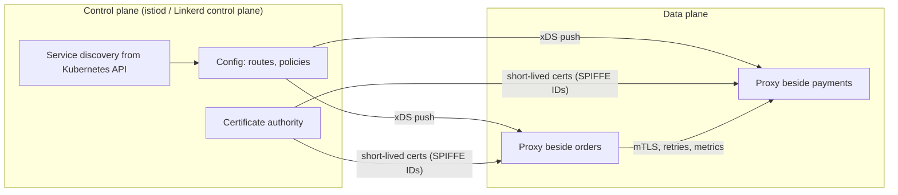
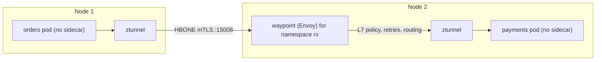

# Service mesh concepts (Istio/Linkerd), sidecar vs ambient

!!! abstract "Key takeaways"
    - A **service mesh** moves service-to-service concerns (mTLS and identity, retries, timeouts, traffic splitting, L7 telemetry) out of application code into **proxies** configured by a **control plane**. It handles **east-west** traffic; an [API gateway](../microservices/03-api-gateway-and-bff-pattern.md) handles north-south.
    - **Sidecar mode** runs a proxy in every pod (Envoy for Istio, the Rust `linkerd2-proxy` for Linkerd): full L7 per pod, but a proxy per pod, a pod restart to upgrade it, and startup/shutdown ordering bugs.
    - **Istio ambient mode** (GA in Istio 1.24, November 2024) uses a per-node **ztunnel** for L4 (mTLS, L4 policy) and an optional per-namespace **waypoint** Envoy only where L7 features are needed.
    - Istio's 1.24 benchmark at 1,000 req/s: sidecar about **0.20 vCPU / 60 MB**, ztunnel about **0.06 vCPU / 12 MB**, waypoint about **0.25 vCPU / 60 MB**.
    - A mesh doesn't replace resilience design: app retries stacked on mesh retries cause **retry amplification**. Adopt one for many services, many languages and zero-trust mTLS; skip it for a handful of Spring services.

## Why it matters

Every call between services needs encryption and caller identity, timeouts, retries, load balancing and trace context. The first generation of microservices put these in **libraries** (Netflix OSS, then Spring Cloud and Resilience4j). That works when everything is Java. It breaks down with Go, Node and Python services in the mix: one library per language, version drift, and a security fix means redeploying everything.

A mesh puts that behaviour in a proxy beside each workload, so a platform team can enforce mTLS, run a weighted canary or see golden signals for every service without code changes. Kubernetes alone gives you L4 Services ([Services, Ingress & Networking](../docker-kubernetes/04-services-ingress-and-networking.md)). It doesn't give you pod-to-pod mTLS, per-request balancing for gRPC, or percentage traffic splits. Istio (CNCF graduated 2023) and Linkerd (2021) are the usual answers to "which mesh?"; Cilium's eBPF mesh is the third name you'll hear.

## Core concepts

### Control plane and data plane


*Notice that the control plane is never on the request path: if istiod goes down, proxies keep serving with their last config and certificates until those expire.*

- **Data plane:** the proxies that carry traffic. They intercept connections (iptables or eBPF), apply routing and policy, and emit telemetry.
- **Control plane:** watches the Kubernetes API, turns CRDs (`VirtualService`, `AuthorizationPolicy`, or Gateway API `HTTPRoute`) into proxy config pushed over **xDS**, and issues short-lived workload certificates. Istio's certificates carry a **SPIFFE identity** such as `spiffe://cluster.local/ns/rx/sa/orders`, derived from the service account. Istio and Linkerd both rotate them every 24 hours by default.

| Capability | What the proxy does | Related page |
|---|---|---|
| mTLS and identity | Encrypts pod-to-pod traffic; authenticates callers by workload identity, not IP | [TLS handshake](../networking/03-tls-handshake.md) |
| Traffic management | Timeouts, retries, outlier detection, per-request L7 balancing (fixes gRPC on ClusterIP) | [Resilience patterns](../microservices/06-resilience-circuit-breaker-retry-bulkhead-timeout-rate-limit.md) |
| Traffic shifting | Weighted canaries, header routing, mirroring | [Deployment strategies](../microservices/11-deployment-strategies-blue-green-canary-feature-flags.md), [GitOps](../cicd-devops/04-gitops-and-deployment-strategies.md) |
| Telemetry | Rate, errors, latency per hop; trace spans | [Tracing with OpenTelemetry](../observability/04-distributed-tracing-with-opentelemetry.md) |

!!! warning "The mesh can't propagate trace context for you"
    Proxies create spans but can't link an inbound request to the outbound calls your code makes. The app must still forward `traceparent` (OpenTelemetry or Micrometer Tracing does it), or you get disconnected single-hop traces.

### Sidecar mode

An admission webhook injects the proxy into each pod, and an init container (or the Istio CNI plugin) adds iptables rules so all traffic passes through it. The app still calls `http://payments:8080` in plain text. Its sidecar upgrades the call to mTLS, and the receiving sidecar terminates it.

{ loading=lazy }
*Watch the retry: the orders app never sees the 503. That's convenient, and it's also why stacked retries are dangerous.*

The costs are one proxy per pod (500 pods means 500 Envoys), memory that grows with mesh config, and a restart of every pod to upgrade the proxy. Ordering used to be a bug factory: apps started before their proxy was ready, and Jobs never completed because the sidecar kept running. **Native sidecars** (init containers with `restartPolicy: Always`, GA in Kubernetes 1.33) start before the app, stop after it, and don't block Job completion.

### Istio ambient mode

Ambient mode takes the proxy out of the pod and splits the data plane in two:

1. **ztunnel** (Rust, a DaemonSet with one per node) handles L4 only: mTLS with workload identities, L4 authorisation and TCP metrics. Between nodes, traffic travels in **HBONE**, an mTLS-encrypted HTTP/2 `CONNECT` tunnel on port 15008.
2. A **waypoint proxy** is an Envoy deployment, usually one per namespace, added only where you need L7: HTTP routing, retries, header-based canaries and L7 authorisation.


*Notice that L4 security covers every pod once the namespace is labelled, while the Envoy L7 hop exists only where a waypoint was requested.*

A pod joins the mesh when its namespace is labelled `istio.io/dataplane-mode=ambient`, with no restart and no injection. You add a waypoint with `istioctl waypoint apply` and the `istio.io/use-waypoint` label.

{ loading=lazy }
*The saving comes from L4-only workloads: they no longer pay for an Envoy each.*

### Istio vs Linkerd vs Cilium

| | Istio | Linkerd | Cilium service mesh |
|---|---|---|---|
| Data plane | Envoy sidecars, or ambient (ztunnel + waypoints) | `linkerd2-proxy` (Rust micro-proxy), sidecar only | eBPF in the kernel + per-node Envoy for L7 |
| Philosophy | Most features: multi-cluster, VMs, rich traffic APIs, egress control | Simplicity: mTLS on by default, little config, low overhead | Mesh built into the CNI |
| Release model | Apache 2.0, CNCF graduated | Apache 2.0 code; since 2024 stable builds come from Buoyant Enterprise, OSS users get edge releases | Apache 2.0, CNCF graduated |

On AWS, **App Mesh was discontinued on 30 September 2026**. AWS points ECS to **Service Connect** and EKS to **VPC Lattice**, and many EKS teams chose Istio instead ([ECS vs EKS](../aws/04-containers-ecs-vs-eks-vs-fargate.md)).

## In practice: code & configuration

The most common mesh mistake in a Spring Boot shop is configuring resilience twice.

=== "❌ Common mistake"
    ```yaml
    # VirtualService: mesh retries 3 times on any 5xx...
    apiVersion: networking.istio.io/v1
    kind: VirtualService
    metadata: { name: payments }
    spec:
      hosts: [payments]
      http:
        - route: [{ destination: { host: payments } }]
          retries: { attempts: 3, retryOn: 5xx }   # retries POSTs too
    ---
    # ...and the Spring app ALSO retries 3 times with Resilience4j
    # resilience4j.retry.instances.payments.max-attempts: 3
    # 3 app attempts x 4 mesh attempts = up to 12 calls per user request,
    # and every hop above that also retries multiplies it again.
    ```

=== "✅ Correct approach"
    ```yaml
    # One layer owns retries. Here the mesh does, for safe failures only,
    # with a per-try timeout inside an overall budget.
    apiVersion: networking.istio.io/v1
    kind: VirtualService
    metadata: { name: payments }
    spec:
      hosts: [payments]
      http:
        - route: [{ destination: { host: payments } }]
          timeout: 2s                     # overall deadline
          retries:
            attempts: 2
            perTryTimeout: 600ms
            retryOn: connect-failure,refused-stream,unavailable,503
    ---
    # Zero-trust baseline: mTLS required, and only orders may call payments
    apiVersion: security.istio.io/v1
    kind: PeerAuthentication
    metadata: { name: default, namespace: rx }
    spec: { mtls: { mode: STRICT } }
    ---
    apiVersion: security.istio.io/v1
    kind: AuthorizationPolicy
    metadata: { name: payments-allow-orders, namespace: rx }
    spec:
      selector: { matchLabels: { app: payments } }
      action: ALLOW
      rules:
        - from: [{ source: { principals: ["cluster.local/ns/rx/sa/orders"] } }]
          to:   [{ operation: { methods: ["POST"], paths: ["/payments"] } }]
    ```
    In the Spring app, keep the circuit breaker and fallback (they need business context), turn off Resilience4j retries for this client, and keep an [idempotency key](../api-design/05-idempotency-keys-and-safe-retries.md) on `POST`.

To move a namespace to `STRICT`, start in `PERMISSIVE` (accepts plain text and mTLS), watch telemetry until no plain-text callers remain, then switch.

## Real-world usage

- **Zero-trust mandates** in banking and healthcare are the most common reason to adopt a mesh: encryption in transit inside the cluster plus identity-based authorisation, with no code changes and a policy file auditors can read.
- **Progressive delivery:** Argo Rollouts and Flagger shift exact traffic weights through Istio, Linkerd or Gateway API and roll back automatically on error rate.
- **Failure modes:** a bad config pushed mesh-wide breaks every service at once. Proxy and control-plane version skew during upgrades, and expired root certificates, are the classic postmortems. Each proxy hop adds a little latency, which adds up on deep call chains.

## Trade-offs & production gotchas

| Option | Pros | Cons | Use when |
|---|---|---|---|
| Libraries (Spring Cloud, Resilience4j) | No extra infrastructure; business context | One per language; redeploy to change; mTLS is DIY | Few services, mostly Java |
| Sidecar mesh | Full L7 per pod; mature | Proxy per pod; restarts to upgrade | Many services needing L7 everywhere |
| Ambient mesh | Cheap mTLS for every pod; no injection | Newer; per-node ztunnel is a shared blast radius; extra waypoint hop for L7 | Large clusters where most workloads need only mTLS |
| No mesh | Simplest (ingress TLS, NetworkPolicy) | No pod-to-pod mTLS or traffic shifting | Small estates |

!!! warning "Gotchas"
    - **Lifecycle:** with legacy sidecars, the app may get traffic before its proxy is ready, or the proxy may exit first. Use native sidecars or Istio's `holdApplicationUntilProxyStarts`.
    - **Protocol detection:** wrong port names or `appProtocol` mean L7 features silently don't apply.
    - **Egress:** a strict mesh may block external SaaS calls until you declare a `ServiceEntry`.
    - **Treat mesh config like code:** review it, roll it out progressively, and upgrade the control plane by revision (canary).

## How this connects to my experience

- **Where I used it:** not used directly; my resume doesn't name a mesh. Position it as transferable knowledge: "Built cloud-native microservices on AWS using … ECS, EKS" (Deloitte ConvergeHealth), Kubernetes (EKS/AKS) and Spring Cloud in my skills, and "Built secure enterprise APIs using OAuth2, PingFederate…" (OptumRx Meteor).
- **Talking points:**
    - I've solved these problems at the library and gateway layer (Spring Cloud, OAuth2, JWT), so I know what a mesh can take over (transport mTLS, retries) and what it can't (user authorisation, business fallbacks).
    - The GraphQL Consumer Service fans out to 5 upstream systems, exactly where timeouts and retry budgets matter. *[confirm: Meteor's runtime platform and whether any mesh or sidecar was in place]*
    - On ConvergeHealth's EKS, service security was IAM, KMS and Secrets Manager. Say "I'd evaluate a mesh or VPC Lattice for mTLS today", not that you ran one. *[confirm: whether App Mesh or any mesh was used there]*
- **Likely follow-up chain:** "Have you used Istio?" → "How did you secure service-to-service calls?" → "When would you add a mesh?". Answer honestly (no), then OAuth2 client credentials and JWT validation in the app, network isolation, TLS at ingress. Add a mesh for many services, several languages and a zero-trust mandate, and choose ambient if most services need only mTLS.

## Interview questions

### Fundamentals

??? question "Q1. What is a service mesh, and what problem does it solve?"
    **Answer:** An infrastructure layer for service-to-service traffic: proxies on the request path, configured by a control plane. It moves mTLS and identity, retries, timeouts, load balancing, traffic shifting and telemetry out of each service's code, so they behave the same in every language and change without redeploying apps.

    **Interviewer listens for:** data plane vs control plane, east-west traffic, language independence.

    **Common wrong answer:** "It's an API gateway for internal services" or "It replaces Kubernetes Services."

??? question "Q2. How is a mesh different from an API gateway?"
    **Answer:** A gateway sits at the edge for north-south traffic: client authentication, per-consumer rate limits, request transformation. A mesh handles east-west traffic with workload identity, mTLS and per-hop resilience. Many platforms run both; Istio's ingress gateway is just an edge Envoy configured by the same control plane.

    **Interviewer listens for:** north-south vs east-west, user identity vs workload identity.

    **Common wrong answer:** "Use one or the other."

??? question "Q3. What is the sidecar pattern, and what does it cost?"
    **Answer:** A helper container in the same pod, sharing its network namespace, that intercepts all traffic. Costs: CPU and memory per pod (about 0.2 vCPU and 60 MB per 1,000 req/s for Envoy in Istio's 1.24 benchmark), a restart to upgrade, and lifecycle ordering problems. Native sidecars, GA in Kubernetes 1.33, fix the ordering.

    **Interviewer listens for:** shared network namespace, per-pod cost, lifecycle ordering.

    **Common wrong answer:** "No overhead, it's just a container."

### Intermediate

??? question "Q4. Explain Istio ambient mode."
    **Answer:** There's no proxy in the pod. A per-node ztunnel provides L4 mTLS, L4 policy and TCP telemetry over HBONE tunnels. Where L7 is needed, you deploy a waypoint Envoy (usually per namespace) and traffic for those services goes through it. Pods join by namespace label without restarts. It went GA in Istio 1.24.

    **Interviewer listens for:** L4/L7 split, ztunnel per node, optional waypoint, no injection.

    **Common wrong answer:** "Ambient means no proxies at all" or "It's eBPF only."

??? question "Q5. How does mesh mTLS establish service identity?"
    **Answer:** The control plane's CA issues each workload a short-lived X.509 certificate whose SAN is a SPIFFE ID derived from its namespace and service account. Both proxies present certificates, so each side knows the other's workload identity, and policies match on identity, not IPs. Rotation is automatic, every 24 hours by default.

    **Interviewer listens for:** service account to SPIFFE ID, auto-rotation, identity not IP.

    **Common wrong answer:** "It uses the pod IP to identify callers."

??? question "Q6. Istio or Linkerd: how would you choose?"
    **Answer:** Linkerd is simpler and lighter: Rust micro-proxies, mTLS by default, little config, but since 2024 stable builds come from Buoyant's enterprise distribution. Istio has the broadest feature set: ambient mode, multi-cluster, VM workloads, rich traffic APIs. Choose by required features, operations capacity and support model.

    **Interviewer listens for:** trade-offs, awareness of ambient and the release-model change.

    **Common wrong answer:** "Istio, because it's the most popular."

### Senior

??? question "Q7. What is retry amplification, and how do you prevent it in a mesh?"
    **Answer:** When several layers each retry, attempts multiply: 3 retries at each of 3 hops is up to 64 calls to the deepest service, exactly when it's struggling. To prevent it, have one layer own retries, retry only transient failures on idempotent requests, put per-try timeouts inside an overall deadline, and add retry budgets and circuit breakers.

    **Interviewer listens for:** multiplication, one owner, idempotency, deadlines.

    **Common wrong answer:** "More retries make it more reliable."

??? question "Q8. When would you not adopt a service mesh?"
    **Answer:** A handful of services in one language, no platform team to operate and upgrade it, or no requirement for pod-to-pod mTLS or traffic shifting. Libraries plus ingress TLS and NetworkPolicy are cheaper. A mesh is also a shared failure domain: one bad config push affects everything.

    **Interviewer listens for:** operational cost, blast radius, requirements first.

    **Common wrong answer:** "Every microservice system needs one."

### Scenario-based

??? question "Q9. Security requires encrypted, authenticated traffic between all 200 services in a cluster, and most are simple REST services. What do you propose?"
    **Answer:** Istio ambient. Move namespaces into ambient without restarts, run `PeerAuthentication` in `PERMISSIVE` and then `STRICT` once telemetry shows no plain-text callers, and add `AuthorizationPolicy` per service account. Add waypoints only for services that need L7. Plan control-plane upgrades and root certificate rotation from day one. Keep OAuth2/JWT in the apps: mTLS proves the workload, not the user.

    **Interviewer listens for:** phased rollout, identity-based policy, L4-first economics, mTLS ≠ user authorisation.

    **Common wrong answer:** "Configure TLS in every Spring app."

??? question "Q10. After adding sidecars, a Kubernetes Job never completes and some pods fail their first requests. Why?"
    **Answer:** A legacy sidecar is a regular container: it never exits, so the Job's pod keeps running, and at startup the app can call out before its proxy is ready. The fix is native sidecars (an init container with `restartPolicy: Always`), which start first and are stopped after the main containers finish. Alternatives are Istio's `holdApplicationUntilProxyStarts` or ambient mode.

    **Interviewer listens for:** lifecycle ordering, native sidecars, ambient as an alternative.

    **Common wrong answer:** "Increase the Job's timeout."

## Cheat sheet

| Concept | Remember |
|---|---|
| Mesh | Proxies (data plane) + control plane; east-west traffic |
| Control plane | Off the request path; pushes xDS config, issues certs |
| Identity | SPIFFE ID from the service account; 24 h certs by default |
| Sidecar | Proxy per pod; full L7; native sidecars (K8s 1.33 GA) fix ordering |
| Ambient | ztunnel per node (L4, HBONE :15008) + optional waypoint (L7); GA in Istio 1.24 |
| Cost (Istio 1.24, 1k rps) | Sidecar 0.20 vCPU/60 MB; ztunnel 0.06/12 MB; waypoint 0.25/60 MB |
| Linkerd | Rust micro-proxy, mTLS by default; stable builds via Buoyant since 2024 |
| AWS | App Mesh discontinued 30 Sep 2026 → Service Connect (ECS), VPC Lattice (EKS) |
| Retries | One layer owns them; idempotent only; per-try timeout inside a deadline |
| STRICT mTLS | PERMISSIVE first, watch telemetry, then STRICT |

## Sources

1. [Istio: Ambient mode reaches general availability in v1.24](https://istio.io/latest/blog/2024/ambient-reaches-ga/): ztunnel, waypoints and APIs stable.
2. [Istio: Performance and scalability](https://istio.io/latest/docs/ops/deployment/performance-and-scalability/): sidecar, ztunnel and waypoint resource use at 1,000 req/s (Istio 1.24).
3. [Istio docs: Ambient mode overview](https://istio.io/latest/docs/ambient/overview/): L4/L7 split, HBONE, namespace labels.
4. [Istio docs: Security concepts](https://istio.io/latest/docs/concepts/security/): SPIFFE identities, PeerAuthentication, AuthorizationPolicy.
5. [Linkerd: Automatic mTLS](https://linkerd.io/2-edge/features/automatic-mtls/): mTLS by default, 24-hour proxy certificates.
6. [Linkerd: Releases and versions](https://linkerd.io/releases/): edge releases vs enterprise stable releases.
7. [Kubernetes: Sidecar containers](https://kubernetes.io/docs/concepts/workloads/pods/sidecar-containers/): `restartPolicy: Always` init containers, stable in 1.33.
8. [AWS: Migrating from AWS App Mesh to Amazon ECS Service Connect](https://aws.amazon.com/blogs/containers/migrating-from-aws-app-mesh-to-amazon-ecs-service-connect/): App Mesh discontinued 30 September 2026.
9. [Buoyant: What is a service mesh?](https://buoyant.io/what-is-a-service-mesh): the original definition of a mesh as an infrastructure layer.
