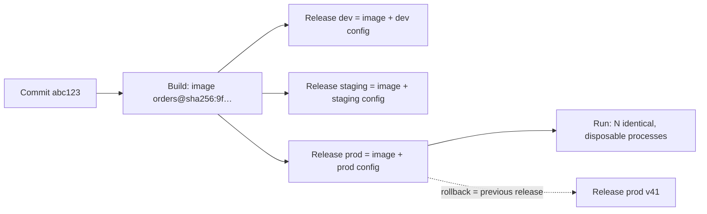
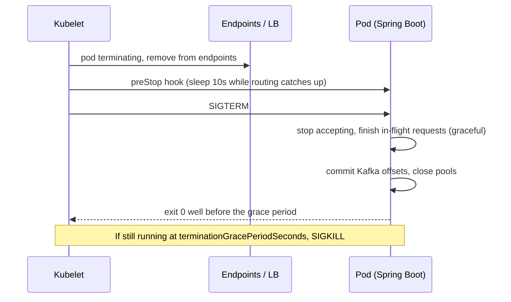

# 12-factor apps & cloud-native principles

!!! abstract "Key takeaways"
    - The **Twelve-Factor App** (Adam Wiggins, Heroku, 2011; open-sourced for community revision in November 2024) is the contract that lets a platform **build once, configure per environment, scale out and replace instances at will**. Kubernetes assumes your app honours it.
    - The most-asked factors: **III Config** (in the environment, not the build), **V Build, release, run** (one immutable artifact + config = a release), **VI Processes** (stateless), **IX Disposability** (fast start, graceful shutdown on `SIGTERM`) and **XI Logs** (event stream to stdout).
    - Some advice has aged: keep **secrets out of plain environment variables** (mounted files or a secrets manager), and run **migrations as a one-off Job** (XII), not in every replica's startup.
    - **Beyond the twelve** (Hoffman, 2016) adds **API first, telemetry, and authentication/authorisation**. The CNCF definition (v1.1, 2024): loosely coupled systems that are secure, resilient, manageable, sustainable and observable.
    - Spring Boot 3.x helps: env-var relaxed binding, `configtree:` for mounted secrets, Kubernetes probes, buildpack images, and **graceful shutdown by default since 3.4**.

## Why it matters

Before containers, apps were pets: a WAR copied to a named server, properties edited in place, logs on local disk, sessions in memory. Heroku ran thousands of apps on shared, disposable infrastructure, and wrote down the contract that made it possible: the twelve factors.

Kubernetes, ECS and every PaaS assume the same contract. They kill and reschedule pods without asking, add replicas to scale, inject config at runtime and collect stdout. An app with in-memory sessions, a hard-coded URL, a 90-second startup or no `SIGTERM` handling works in a demo and fails at the first rolling update. "Is it twelve-factor?" is interview shorthand for "will it survive on a platform?".

## Core concepts

### The twelve factors, mapped to Spring Boot on Kubernetes

| # | Factor | Rule | Spring Boot / Kubernetes form | Go deeper |
|---|---|---|---|---|
| I | Codebase | One codebase in version control, many deploys | One repo (or module) per deployable; same commit to dev, staging, prod | [CI/CD pipeline design](../cicd-devops/01-ci-cd-pipeline-design.md) |
| II | Dependencies | Declare and isolate explicitly | Maven/Gradle lockfile; fat jar in a container image; no "it's installed on the server" | [Images & layers](../docker-kubernetes/01-containers-vs-vms-docker-images-layers-multi-stage-builds.md) |
| III | Config | Config in the environment, not the code | Env vars and mounted files bound to `@ConfigurationProperties`; ConfigMaps and Secrets | [Spring config](../spring-boot/03-configuration-properties-profiles-configurationproperties.md), [Config & secrets](../microservices/09-configuration-and-secrets-management.md) |
| IV | Backing services | Treat them as attached resources | Postgres, Kafka, Redis and S3 are URLs plus credentials; swapping one means changing config, not code | |
| V | Build, release, run | Strictly separate stages | CI builds an image once (by digest); a release is image + environment config; the cluster runs it | [GitOps & deployment](../cicd-devops/04-gitops-and-deployment-strategies.md) |
| VI | Processes | Stateless, share nothing | No in-memory sessions or local files that matter; state goes to a DB, Redis or S3 | [Stateless scaling](../system-design/03-scalability-vertical-vs-horizontal-stateless-services-load-b.md) |
| VII | Port binding | Export services by binding a port | Embedded Tomcat/Netty on `server.port`; no external app server | |
| VIII | Concurrency | Scale out via the process model | More replicas (HPA), separate Deployments for web and worker processes | [Probes & autoscaling](../docker-kubernetes/06-probes-resource-requests-limits-autoscaling.md) |
| IX | Disposability | Fast startup, graceful shutdown | Handle `SIGTERM`, drain in-flight work, idempotent consumers; keep startup to seconds | [Rolling updates](../docker-kubernetes/07-rolling-updates-rollbacks-and-helm.md) |
| X | Dev/prod parity | Keep environments similar | Same image everywhere; Testcontainers with real Postgres and Kafka, not H2 | |
| XI | Logs | Treat logs as event streams | JSON to stdout; the platform ships them (Fluent Bit, CloudWatch, Azure Monitor) | [Structured logging](../observability/02-structured-logging-and-correlation-ids.md) |
| XII | Admin processes | Run one-off tasks as one-off processes | Migrations, backfills and data fixes as a Kubernetes `Job` from the same image | |

### Build, release, run


*Notice that only config differs between environments, so what you tested in staging is byte-for-byte what runs in prod, and a rollback just re-selects an earlier release.*

{ loading=lazy }
*If an environment needs a rebuild, config has leaked into the build.*

### Processes and disposability

**Stateless processes** (VI) make scaling, rolling updates and self-healing possible: any replica can serve any request. Common hidden state in Spring apps:

- HTTP sessions in memory. Use Spring Session with Redis, or stateless JWTs.
- Uploaded files on local disk. Use object storage.
- In-process caches treated as truth. Fine only if a miss is safe.
- Scheduled jobs that run on every replica. Use a leader lock (ShedLock) or move them to a separate worker or CronJob.

**Disposability** (IX) means the platform can stop you at any moment without losing work. On Kubernetes: the pod is marked terminating and removed from endpoints, `preStop` runs, the container gets `SIGTERM`, and after `terminationGracePeriodSeconds` (default 30 s) `SIGKILL`. Endpoint removal reaches kube-proxy, ingress and mesh proxies **asynchronously**, so a short `preStop` sleep stops new requests landing on a pod that has stopped listening.


*Notice that the preStop sleep plus Spring's drain window must fit inside the grace period, or the kubelet kills requests mid-flight anyway.*

{ loading=lazy }
*Watch the budget: preStop plus the drain must end before the grace period, not just before Spring's own timeout.*

Fast startup is the other half: Class Data Sharing, Spring AOT or GraalVM native images where seconds matter, and a `startupProbe` so liveness doesn't kill a pod that's still booting.

### Where the original twelve factors have aged

| Original advice | Today's practice | Why |
|---|---|---|
| III: all config in env vars, **including secrets** | Secrets as mounted files (`configtree:`) or from Vault / AWS Secrets Manager / Azure Key Vault | Env vars leak into crash dumps, `/proc`, child processes and CI logs |
| XII: admin tasks in an identical environment (often read as "at startup") | Migrations as a pre-deploy `Job`, expand then contract | 10 replicas racing a Liquibase lock; one failure blocks every pod |
| XI: plain-text logs to stdout | Structured JSON with trace IDs, plus metrics and traces | Logs alone aren't observability |
| VIII: scale process types by hand | Autoscaling on CPU, custom metrics or queue lag (HPA, KEDA) | The platform scales for you |

**Beyond the Twelve-Factor App** (Kevin Hoffman, O'Reilly, 2016) adds **API first** ([OpenAPI & API-first](../api-design/07-openapi-and-api-first-development.md)), **telemetry** ([logs, metrics and traces](../observability/01-logs-metrics-and-traces.md)) and **authentication and authorisation** in every service, not just at the perimeter.

### Cloud-native principles

The CNCF definition (v1.1, 2024) is the reference answer: workloads deployed "in a programmatic and repeatable manner" as **loosely coupled systems** that are **secure, resilient, manageable, sustainable and observable**, typically using containers, service meshes, microservices, immutable infrastructure, serverless and declarative APIs. In practice:

- **Immutable infrastructure:** replace, never patch in place.
- **Declarative desired state** with controllers reconciling it (the basis of GitOps).
- **Design for failure:** timeouts, retries, circuit breakers, idempotency ([resilience patterns](../microservices/06-resilience-circuit-breaker-retry-bulkhead-timeout-rate-limit.md)).
- **Elasticity**, which needs factors VI, VIII and IX.
- **Observability and automation;** a [service mesh](01-service-mesh-concepts-sidecar-vs-ambient.md) is one way to get uniform telemetry and mTLS.

Cloud native isn't the same as microservices. A twelve-factor modular monolith running as three replicas is cloud native; 40 services sharing one database is not ([when not to use microservices](../microservices/01-monolith-vs-microservices-when-not-to-use-microservices.md)).

## In practice: code & configuration

=== "❌ Common mistake"
    ```java
    // application-prod.yml baked into the jar:
    //   spring.datasource.url: jdbc:postgresql://prod-db-01:5432/rx
    //   spring.datasource.password: S3cret!        <- secret in the artifact (III)
    //   logging.file.name: /var/log/orders.log      <- lost when the pod dies (XI)
    @RestController
    class CartController {
        private final Map<String, Cart> carts = new ConcurrentHashMap<>(); // state in the process (VI)

        @PostMapping("/cart/{user}/items")
        Cart add(@PathVariable String user, @RequestBody Item item) {
            return carts.computeIfAbsent(user, u -> new Cart()).add(item);
            // the next request may hit another replica: the cart "disappears"
        }
    }
    // + Dockerfile runs "mvn package -Pprod" per environment (V: one build per env)
    ```

=== "✅ Correct approach"
    ```java
    // application.yml: defaults only; real values come from the environment
    //   spring.config.import: "optional:configtree:/etc/secrets/"   # mounted Secret files
    //   spring.datasource.url: ${DB_URL}                           # env var from ConfigMap
    //   spring.threads.virtual.enabled: true
    //   management.endpoint.health.probes.enabled: true           # auto-on in Kubernetes
    //   spring.lifecycle.timeout-per-shutdown-phase: 20s          # graceful is the default in 3.4+
    //   logging.structured.format.console: ecs                    # JSON to stdout (Boot 3.4+)
    @ConfigurationProperties("orders")
    record OrdersProperties(Duration paymentTimeout, URI pricingUrl) {} // typed, validated config

    @RestController
    class CartController {
        private final CartRepository carts; // Redis-backed: any replica can serve any user

        CartController(CartRepository carts) { this.carts = carts; }

        @PostMapping("/cart/{user}/items")
        Cart add(@PathVariable String user, @RequestBody Item item) {
            return carts.addItem(user, item);
        }
    }
    ```
    ```yaml
    # Deployment excerpt: disposability budget
    spec:
      terminationGracePeriodSeconds: 40        # > preStop (10s) + drain (20s)
      containers:
        - name: orders
          image: registry.example.com/orders@sha256:9f…   # same digest in every env
          envFrom: [{ configMapRef: { name: orders-config } }]
          volumeMounts: [{ name: secrets, mountPath: /etc/secrets, readOnly: true }]
          lifecycle:
            preStop: { exec: { command: ["sleep", "10"] } }  # let endpoints update
          startupProbe:   { httpGet: { path: /actuator/health/liveness,  port: 8080 }, failureThreshold: 30, periodSeconds: 2 }
          livenessProbe:  { httpGet: { path: /actuator/health/liveness,  port: 8080 } }
          readinessProbe: { httpGet: { path: /actuator/health/readiness, port: 8080 } }
    ```

Build the image with `./mvnw spring-boot:build-image` (Cloud Native Buildpacks) or a multi-stage Dockerfile. Either way it's built once and promoted by digest. The [Actuator page](../spring-boot/08-actuator-health-checks-metrics.md) covers what the liveness and readiness groups should and shouldn't check.

## Real-world usage

- **Heroku, Cloud Foundry and App Engine** enforce the factors as platform rules. Kubernetes doesn't, so teams rediscover them through outages.
- **Deploys that drop requests** are the classic disposability failure: no `preStop` delay, `SIGTERM` ignored, or a grace period shorter than the drain. Users see 502s every release.
- **Session loss under autoscaling:** an app that worked on two sticky-session VMs loses carts when the HPA scales to 12 pods.
- **Regulated domains** want factor III for audit reasons: managed, rotated secrets and identical artifacts across environments ([HIPAA & PHI](../compliance-privacy/01-hipaa-and-phi-handling.md)).

## Trade-offs & production gotchas

| Choice | Pros | Cons | Use when |
|---|---|---|---|
| Env vars for config | Universal, simple, visible in the manifest | Leak easily; flat key space; restart to change | Non-secret settings |
| Mounted files (`configtree:`) | Secrets stay off the env; files can update in place | Needs a volume; app must re-read to pick up changes | Kubernetes Secrets, CSI secret store |
| Config server / secrets manager | Central, audited, dynamic refresh | Extra dependency at startup; another thing to secure | Many services, rotation requirements |

!!! warning "Gotchas"
    - **Profiles aren't environments:** `application-prod.yml` with real values in the jar breaks factor III. Use profiles for behaviour, not per-environment values.
    - **JVM memory:** use `-XX:MaxRAMPercentage` with container limits, not a VM-era `-Xmx` ([JVM memory](../java-concurrency-jvm/08-jvm-architecture-class-loading-jit-memory-areas.md)).
    - **Kafka on shutdown:** commit offsets, leave the group and keep handlers idempotent; a kill mid-batch replays messages.
    - **Liveness probes that check the database** turn a DB blip into a restart storm.

## How this connects to my experience

- **Where I used it:** the factors sit under resume lines rather than being named. "Built cloud-native microservices on AWS using Lambda, EC2, ECS, EKS…" (Deloitte ConvergeHealth); "Liquibase migration strategies" (XII); "IAM, KMS, and Secrets Manager" (III); "Established engineering standards around testing, CI/CD, code quality, and deployment practices" (OptumRx Meteor, V and X); "Redis-based caching" (state out of the process).
- **Talking points:**
    - Secrets from Secrets Manager rather than properties files. *[confirm: how ConvergeHealth services loaded secrets: SDK at startup, ECS task-definition secrets, or EKS CSI driver]*
    - Liquibase at startup or as a pipeline step, and how backward compatibility was handled. *[confirm: the actual Liquibase run model on ConvergeHealth]*
    - Meteor standards: build once and promote, same image everywhere, structured logs. *[confirm: which of these were in Meteor's standards, and the runtime platform]*
- **Likely follow-up chain:** "What makes a service cloud native?" → "How does your service shut down during a deploy?" → "Where do secrets live?" → "How do migrations run with 10 replicas?". Answer with the factors, the SIGTERM sequence with numbers, mounted secrets or a secrets manager, and expand/contract migrations in a Job.

## Interview questions

### Fundamentals

??? question "Q1. What is a twelve-factor app? Name the factors you consider most important."
    **Answer:** Heroku's 2011 methodology for apps a platform can build once, configure per environment, scale out and replace freely. The twelve: codebase, dependencies, config, backing services, build/release/run, processes, port binding, concurrency, disposability, dev/prod parity, logs, admin processes. On Kubernetes the critical ones are config, build/release/run, stateless processes, disposability and logs.

    **Interviewer listens for:** the why (platform can build once, scale, replace), not a recited list.

    **Common wrong answer:** "It's about microservices." It applies to monoliths too.

??? question "Q2. Why should config live outside the build artifact?"
    **Answer:** So one immutable artifact is promoted through every environment: what you tested is what ships, config changes need no rebuild, and secrets never land in images or repos. Test: could you open-source the code now without leaking a credential?

    **Interviewer listens for:** build once, promote; secrets not in images.

    **Common wrong answer:** "Use a Spring profile per environment with the values inside the jar."

??? question "Q3. What does stateless mean for a Spring Boot service, and where does state go?"
    **Answer:** No request depends on one instance's memory or disk. Sessions go to Redis (Spring Session) or JWTs, files to object storage, durable state to databases; local caches only if a miss is harmless. Then any replica can serve any request.

    **Interviewer listens for:** concrete hidden-state examples, backing services.

    **Common wrong answer:** "Stateless means no database."

### Intermediate

??? question "Q4. Walk through what happens when Kubernetes stops your pod, and how you avoid dropped requests."
    **Answer:** The pod is marked terminating and removed from endpoints (asynchronously), preStop runs, SIGTERM is sent, and SIGKILL follows after `terminationGracePeriodSeconds` (default 30 s). Add a short preStop sleep so routing catches up, rely on Spring Boot's graceful shutdown (default since 3.4) with `timeout-per-shutdown-phase`, close consumers cleanly, and fit preStop plus drain inside the grace period.

    **Interviewer listens for:** ordering, async endpoint removal, the time budget.

    **Common wrong answer:** "Kubernetes waits until requests finish."

??? question "Q5. Are environment variables a good place for secrets?"
    **Answer:** That was the original factor III advice, but env vars leak through process listings, crash dumps, child processes and debug endpoints. Prefer files mounted from Secrets (`configtree:`) with tight RBAC, or a secrets manager with rotation. Env vars stay fine for non-secret config.

    **Interviewer listens for:** awareness that the factor has aged, concrete alternatives.

    **Common wrong answer:** "Yes, Kubernetes Secrets in env vars are encrypted." They're base64 in the manifest and plain text in the process.

??? question "Q6. How should database migrations run in a twelve-factor deployment?"
    **Answer:** As an admin process (XII): a one-off Job or pipeline step with the same image and config, before the rollout. Keep them backward compatible so old and new pods coexist: expand, deploy, contract later. Running them in every replica's startup causes lock contention and turns one failure into a blocked rollout.

    **Interviewer listens for:** same image, one run, expand/contract.

    **Common wrong answer:** "Each service runs Liquibase on startup and it's fine at any scale."

### Senior

??? question "Q7. What does cloud native mean beyond 'runs in containers'?"
    **Answer:** Per the CNCF: loosely coupled systems that are secure, resilient, manageable, sustainable and observable, deployed programmatically and repeatably. Concretely: immutable artifacts, declarative desired state, design for failure, elasticity, automation, observability. A twelve-factor monolith on Kubernetes can be cloud native; a lift-and-shift VM in a container usually isn't.

    **Interviewer listens for:** principles over tools, immutability, declarative reconciliation.

    **Common wrong answer:** "Cloud native means microservices on Kubernetes."

??? question "Q8. Which twelve-factor principles would you add or change for a modern platform?"
    **Answer:** Add API first, telemetry, and authentication/authorisation (Hoffman). Change secrets to files or a secrets manager, migrations to gated Jobs, logs to structured JSON with trace IDs, and manual scaling to autoscaling. The methodology itself has been under community revision since 2024.

    **Interviewer listens for:** judgement about what has aged, not dogma.

    **Common wrong answer:** "Nothing; the twelve factors are complete."

### Scenario-based

??? question "Q9. Every deploy of a Spring Boot service causes a burst of 502s and some duplicate Kafka processing. Diagnose it."
    **Answer:** 502s: the pod stops listening while ingress or mesh still routes to it. Look for no preStop delay, `server.shutdown=immediate`, or a grace period shorter than preStop plus drain. Duplicates: consumers killed mid-batch before committing offsets; close them on shutdown and keep handlers idempotent. Also check `maxUnavailable`/`maxSurge` capacity.

    **Interviewer listens for:** the endpoint propagation race, the time budget, idempotency.

    **Common wrong answer:** "Increase replicas."

??? question "Q10. You inherit a legacy service with sticky sessions, file logs and per-environment builds. How do you make it cloud-ready incrementally?"
    **Answer:** Incrementally, by risk and value: build once and inject config (III/V), logs to stdout as JSON (XI), sessions to Redis and files to object storage (VI, which unlocks dropping stickiness and autoscaling), then probes and graceful shutdown (IX) and migrations as a Job (XII). Verify each step with a rolling deploy under load.

    **Interviewer listens for:** sequencing, verification, no big-bang rewrite.

    **Common wrong answer:** "Rewrite it as microservices."

## Cheat sheet

| Concept | Remember |
|---|---|
| Origin | Heroku, Adam Wiggins, 2011; open source and under revision since Nov 2024 |
| III Config | In the environment; secrets as files or from a manager, not baked or plain env |
| V Build/release/run | Build once (digest) + config = release; rollback = previous release |
| VI Processes | Stateless; sessions to Redis, files to S3 |
| IX Disposability | preStop sleep → SIGTERM → drain → exit < grace period (default 30 s) |
| Spring Boot | Graceful shutdown default since 3.4; probes auto-enabled on Kubernetes; `configtree:` |
| XI Logs | JSON to stdout with trace IDs |
| XII Admin | Migrations as a one-off Job; expand/contract |
| Beyond 12 | API first, telemetry, authN/authZ (Hoffman 2016) |
| Cloud native (CNCF v1.1) | Loosely coupled; secure, resilient, manageable, sustainable, observable |

## Sources

1. [The Twelve-Factor App](https://12factor.net/): the twelve factors and their rationale.
2. [12factor.net: Twelve-Factor App methodology is now open source](https://12factor.net/blog/open-source-announcement): November 2024 open-sourcing and community revision.
3. [CNCF TOC: Cloud Native definition v1.1](https://github.com/cncf/toc/blob/main/DEFINITION.md): the definition quoted above.
4. [Kevin Hoffman, *Beyond the Twelve-Factor App* (O'Reilly, 2016)](https://www.oreilly.com/library/view/beyond-the-twelve-factor/9781492042631/): API first, telemetry, authentication and authorisation.
5. [Spring Boot reference: Graceful shutdown](https://docs.spring.io/spring-boot/reference/web/graceful-shutdown.html): enabled by default, `timeout-per-shutdown-phase`.
6. [Spring blog: Bootiful Spring Boot 3.4](https://spring.io/blog/2024/11/24/bootiful-34-boot): graceful shutdown by default and structured logging in 3.4.
7. [Spring Boot reference: Kubernetes probes and config trees](https://docs.spring.io/spring-boot/reference/features/external-config.html#features.external-config.files.configtree): `configtree:` imports; liveness and readiness groups.
8. [Kubernetes: Pod lifecycle, termination of pods](https://kubernetes.io/docs/concepts/workloads/pods/pod-lifecycle/#pod-termination): preStop, SIGTERM, grace period default 30 s.
